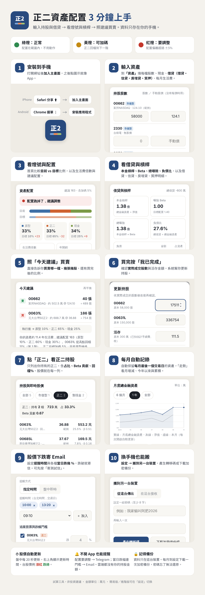

# 正二資產配置 Lite

手機、平板、電腦都能用的資產配置工具：輸入持股，自動抓股價，算出 Beta、建議配置（原型／正二／現金），並告訴你要買賣哪幾檔、幾張。

- **全部免費**：網站放 GitHub Pages，股價與提醒用 Cloudflare Workers 免費方案，Email 用 Resend 免費方案
- **提醒**：配置跑掉時 Telegram 通知；追蹤股票當日跌幅達設定 % 時 Email 通知（可設提醒時間）
- **個資不上雲**：持股與金額只存在你的裝置；雲端提醒只收到「比例」
- **每月自動保留月底資產**：跨月後以最後一個交易日收盤價定案，看月增減與累積變化
- **公式與 Excel 一致**：以「阿良的正二人生」範本 2026/09 驗算值做自動測試



---

## 目錄

1. [專案內容](#1-專案內容)
2. [部署網站到 GitHub Pages（必做，約 10 分鐘）](#2-部署網站到-github-pages必做約-10-分鐘)
3. [部署 Cloudflare Worker：即時股價、轉移碼（建議，約 15 分鐘）](#3-部署-cloudflare-worker即時股價轉移碼建議約-15-分鐘)
4. [設定 Telegram 配置提醒（選用，約 10 分鐘）](#4-設定-telegram-配置提醒選用約-10-分鐘)
5. [設定 Email 股價下跌提醒（選用，約 10 分鐘）](#5-設定-email-股價下跌提醒選用約-10-分鐘)
6. [在手機上使用](#6-在手機上使用)
7. [之後要更新程式](#7-之後要更新程式)
8. [常見問題](#8-常見問題)
9. [安全說明](#9-安全說明)

---

## 1. 專案內容

```
lev2-lite/
├─ docs/                 ← 網站本身（GitHub Pages 發布這個資料夾）
│  ├─ index.html
│  ├─ css/app.css        ← 響應式樣式：手機底部分頁、平板側欄＋雙欄、桌機側欄＋多欄
│  ├─ js/
│  │  ├─ app.js          ← 畫面
│  │  ├─ engine/         ← 計算引擎（資產、級距、加碼、再平衡、推薦、下跌提醒；網站與 Worker 共用）
│  │  ├─ backup.js       ← 加密匯出／匯入、轉移碼
│  │  ├─ data.js         ← 本機儲存、範例資料
│  │  └─ quotes.js       ← 盤中每 20 秒更新股價
│  ├─ sw.js、manifest.webmanifest、icons/   ← 安裝成 App 用
│  └─ guide.png          ← 使用教學圖
├─ worker/
│  ├─ dist/worker.js     ← ★ 單一檔案版，貼到 Cloudflare 網頁即可
│  ├─ src/index.js       ← Worker 原始碼
│  └─ wrangler.toml      ← 用指令部署時的設定
├─ design/               ← 系統設計稿（完整版、簡化版）
├─ test/                 ← 自動測試（56 項）
└─ .github/workflows/test.yml   ← 推送時自動跑測試
```

> **只部署第 2 步也能用**：沒有 Worker 時，股價改在「資產」頁手動輸入。

---

## 2. 部署網站到 GitHub Pages（必做，約 10 分鐘）

全程在瀏覽器完成，不用安裝任何軟體。

### 2-1 建立 repository

1. 登入 [github.com](https://github.com)（沒有帳號先註冊）
2. 右上角 **＋ → New repository**
3. Repository name 填 `lev2-lite`
4. 選 **Public**（免費帳號的 GitHub Pages 需要公開 repository；裡面只有程式碼，**沒有你的資產資料**）
5. 按 **Create repository**

### 2-2 上傳檔案

1. 解壓縮 `lev2-lite.zip`
2. 在剛建立的 repository 頁面點 **uploading an existing file**
3. 打開解壓縮後的 `lev2-lite` 資料夾，**把裡面所有檔案和資料夾**（docs、worker、design、test、scripts、README.md、package.json…）一起拖進網頁
4. 下方按 **Commit changes**

> **Mac 注意**：`.github` 資料夾開頭是「.」，Finder 預設看不到。按 `Command + Shift + .` 顯示隱藏檔再一起拖。沒上傳也不影響網站，只是不會自動跑測試。

### 2-3 開啟 GitHub Pages

1. repository 上方 **Settings → 左側 Pages**
2. **Source** 選 **Deploy from a branch**
3. **Branch** 選 `main`，資料夾選 **`/docs`**，按 **Save**
4. 等 1～2 分鐘，重新整理，上方會出現網址：
   `https://你的帳號.github.io/lev2-lite/`

打開網址看到「開始使用」就成功了。可以先按「先看範例」試用。

---

## 3. 部署 Cloudflare Worker：即時股價、轉移碼（建議，約 15 分鐘）

Worker 負責：抓證交所即時股價（失敗改抓 Yahoo）、月底收盤價、轉移碼、Telegram 配置提醒、Email 下跌提醒。一樣全程在瀏覽器完成。

> Cloudflare 介面偶爾改版，按鈕名稱可能略有不同，找最接近的選項即可。

### 3-1 建立 Worker

1. 註冊／登入 [dash.cloudflare.com](https://dash.cloudflare.com)（免費方案即可）
2. 左側 **Workers & Pages → Create → Create Worker**（或 Start with Hello World）
3. 名稱填 `lev2-worker` → **Deploy**
4. 按 **Edit code**，把編輯器內容**全部刪掉**
5. 打開專案裡的 `worker/dist/worker.js`，**全選複製**貼上 → 右上 **Deploy**
6. 記下網址：`https://lev2-worker.你的子網域.workers.dev`

### 3-2 建立資料空間（KV）

1. 左側 **Storage & Databases → KV → Create**（名稱填 `LEV2`）
2. 回到 Worker → **Settings → Bindings → Add → KV namespace**
   - Variable name：`LEV2`（一定要大寫完全一樣）
   - KV namespace：選剛建立的 `LEV2` → **Save**

### 3-3 設定變數

Worker → **Settings → Variables and Secrets → Add**：

| 名稱 | 類型 | 值 |
|------|------|------|
| `ALLOWED_ORIGIN` | Text | `https://你的帳號.github.io`（**只到 .io，不加 /lev2-lite**） |
| `APP_URL` | Text | `https://你的帳號.github.io/lev2-lite/` |

按 **Deploy** 儲存。

### 3-4 測試

1. 瀏覽器打開 `https://lev2-worker.你的子網域.workers.dev/quotes?codes=0050,00631L,00865B`
   看到 `"price":` 等數字就表示股價抓得到
2. 打開你的網站 → **設定 → 報價與雲端服務**，貼上 Worker 網址 → **測試連線**
3. 顯示「連線成功：取得 7 檔股價」就完成了。右上角會顯示「盤中 13:25:10」或「收盤」

---

## 4. 設定 Telegram 配置提醒（選用，約 10 分鐘）

App 沒開也能收到「配置要調整」「正二回檔可加碼」通知。雲端只收到各檔**比例**（例如 00631L 25%），**沒有股數、沒有金額**。

### 4-1 建立 Telegram 機器人

1. Telegram 搜尋 **@BotFather** → 傳 `/newbot`
2. 依指示取名字（例如「我的正二提醒」）與帳號（必須以 `bot` 結尾）
3. 收到一串 **token**（像 `123456789:AAH...`），先複製起來
4. 找到你剛建立的機器人，傳任意一句話給它（例如「你好」）
5. 瀏覽器打開 `https://api.telegram.org/bot你的token/getUpdates`
   找到 `"chat":{"id":123456789`，這串數字就是 **chat id**

### 4-2 設定到 Worker

Worker → **Settings → Variables and Secrets → Add**，類型都選 **Secret**：

| 名稱 | 值 |
|------|------|
| `TELEGRAM_BOT_TOKEN` | 上面的 token |
| `TELEGRAM_CHAT_ID` | 上面的 chat id |
| `NOTIFY_KEY` | 自己設一組 20 字以上的亂碼（例如用密碼管理器產生），網站要填同一組 |

### 4-3 設定排程（盤中每 10 分鐘檢查）

Worker → **Settings → Triggers → Cron Triggers → Add**，填：

```
*/10 1-5 * * MON-FRI
```

（UTC 01:00–05:59＝台北 09:00–13:59，程式內再限制到 13:35 收盤）

### 4-4 在網站開啟

網站 → **設定 → 雲端提醒** → 勾選「開啟雲端提醒」→ 填入 `NOTIFY_KEY` → **寄測試通知**。Telegram 收到測試訊息就完成了。

之後修改持股或按「我已完成」，網站會自動重新上傳比例。點「雲端會收到的內容」可以看到實際上傳的資料。

---

## 5. 設定 Email 股價下跌提醒（選用，約 10 分鐘）

追蹤的股票**今日跌幅**（現價對昨收）達到你設定的 % 時寄信通知。可選：

- **指定時間**：例如每個交易日 10:00、13:20 檢查，有跌破就寄一封彙整信（可設多個時間，09:10–13:30 每 10 分鐘可選）
- **盤中即時**：每 10 分鐘檢查，一跌破就寄；同一檔每天只寄一次

雲端只收到：收件信箱、提醒時間、追蹤代號與門檻。**沒有持股、沒有金額。**

### 5-1 申請免費寄信服務 Resend

1. 到 [resend.com](https://resend.com) 註冊（免費方案每月 3,000 封、每日 100 封）
2. **用來收提醒的信箱註冊**：沒有自己網域時，Resend 只能用 `onboarding@resend.dev` 寄到你註冊的信箱，自己收提醒剛好夠用
3. 左側 **API Keys → Create API Key**（權限選 Sending access）→ 複製 `re_` 開頭的金鑰

> 想寄到其他信箱：在 Resend 驗證自己的網域，再到 Worker 加一個 Text 變數 `MAIL_FROM`，例如 `正二配置 <alert@你的網域>`。

### 5-2 設定到 Worker

Worker → **Settings → Variables and Secrets → Add**：

| 名稱 | 類型 | 值 |
|------|------|------|
| `RESEND_API_KEY` | Secret | 上面的 `re_` 金鑰 |
| `NOTIFY_KEY` | Secret | 自己設一組 20 字以上的亂碼（若第 4 步已設定就不用再加） |

並確認已依 [4-3](#4-3-設定排程盤中每-10-分鐘檢查) 設定 Cron Trigger `*/10 1-5 * * MON-FRI`（兩種提醒共用同一個排程）。

### 5-3 在網站開啟

1. 網站 → **設定 → 報價與雲端服務**：填入 Worker 網址與**雲端密鑰**（＝`NOTIFY_KEY`）
2. **設定 → 股價下跌提醒（Email）**：
   - 勾選「開啟下跌提醒」，填收件信箱（Resend 註冊的那個）
   - 選「指定時間」並加入時間，或選「盤中即時」
   - 勾選要追蹤的股票，設定各檔「跌幾 %」（預設正二 4%、其他 2%）
3. 按 **寄測試信**，收到信就完成了。之後修改設定會自動儲存到雲端

## 6. 在手機上使用

1. **安裝**：iPhone 用 Safari 打開網址 → 分享 →「加入主畫面」；Android 用 Chrome → 選單 →「安裝應用程式」
2. **輸入資產**：「資產」頁填股數、現金、負債、每月生活費（金額單位：萬元）
3. **看首頁**：燈號、目前 vs 目標比例、今天建議（買賣哪檔、幾張）
4. **正二篩選**：首頁「持股與即時股價」點「正二」，只看正二持股、占比、Beta 貢獻
5. **買賣完**：按「我已完成」，確認實際成交股數
6. **每月紀錄（自動）**：每月自動保留最後一個交易日的資產，「走勢」頁看月增減、今年以來、累積變化
7. **下跌提醒**：設定 → 股價下跌提醒，選時間與各檔跌幅 %，跌破時寄 Email
8. **換裝置**：設定 → 搬到另一台裝置 → 轉移碼（新裝置要先填 Worker 網址）或加密備份檔

詳細圖解見上方教學圖。

---

## 7. 之後要更新程式

- **網站**：在 GitHub 上直接編輯 `docs/` 裡的檔案或重新上傳，1～2 分鐘後自動生效
  - 改了 `docs/` 的檔案後，記得把 `docs/sw.js` 第一行的版本號加 1（例如 `lev2-v1.0.1`），手機上的 App 才會抓新版
- **Worker**：修改 `worker/src/index.js` 或 `docs/js/engine/` 後，執行 `npm run build:worker` 重新產生 `worker/dist/worker.js`，再貼到 Cloudflare 編輯器
- **跑測試**（電腦需安裝 Node.js 18 以上）：`npm test`

### 進階：用指令部署 Worker

```bash
cd worker
npx wrangler login
npx wrangler kv namespace create LEV2      # 把印出的 id 貼到 wrangler.toml
# 編輯 wrangler.toml 的 ALLOWED_ORIGIN、APP_URL
npx wrangler secret put NOTIFY_KEY
npx wrangler secret put TELEGRAM_BOT_TOKEN
npx wrangler secret put TELEGRAM_CHAT_ID
npx wrangler secret put RESEND_API_KEY
npx wrangler deploy
```

---

## 8. 常見問題

**Q：網站打開是空白／404？**
GitHub Pages 要選 `/docs` 資料夾；剛開啟要等 1～2 分鐘。網址結尾要有 `/lev2-lite/`。

**Q：「測試連線」失敗？**
① Worker 網址前面要有 `https://`；② `ALLOWED_ORIGIN` 要和網站網域完全一樣（`https://你的帳號.github.io`，結尾不要 `/`）；③ 改完變數要按 Deploy。

**Q：某檔顯示「無股價」？**
證交所與 Yahoo 都抓不到時會發生（例如來源暫時阻擋）。可以在「資產」頁填「手動價」暫時使用。直接打開 `/quotes?codes=代號` 可以看錯誤訊息。

**Q：股價沒有每 20 秒更新？**
只有台股交易時間（週一至週五 09:00–13:35）、而且頁面在前景時才會自動更新；其他時間顯示收盤價。國定假日顯示前一交易日收盤價。

**Q：換了手機資料不見？**
每台裝置的資料是分開的。用「設定 → 搬到另一台裝置」搬移；建議每月下載一次加密備份。

**Q：iPhone 資料被清掉？**
請「加入主畫面」後從圖示開啟。Safari 對很久沒開的一般網頁可能清除資料，加入主畫面的比較不會。

**Q：每月紀錄怎麼來的？**
不用手動存。本月的數字在每次開 App 時自動更新；跨月後第一次開 App，系統會用**上個月最後一個交易日的收盤價**乘上當時的股數重新計算，作為該月定案（標示「月底收盤 10/30」）。所以月底那天沒開 App 也沒關係。
- 需要 Worker 才能取得月底收盤價；沒有 Worker 時以當月最後一次開啟時的價格定案（標示「最後開啟」）
- 某個月整個月都沒開 App 就不會有紀錄，可在「走勢 → 補登過去月份」手動補上
- 月增減＝本月底 − 上月底；今年以來＝對比去年 12 月底；累積＝對比第一筆紀錄

**Q：沒收到下跌提醒信？**
① 按「寄測試信」看錯誤訊息；② 先檢查垃圾郵件匣，把寄件者加入聯絡人；③ 沒驗證網域時只能寄到 Resend 註冊信箱；④ 「指定時間」模式只在那個時間點檢查，當時沒跌破就不寄；⑤ 確認 Cron Trigger 已設定。

**Q：今日跌幅怎麼算？**
（現價 − 昨日收盤價）÷ 昨日收盤價，和券商 App 顯示的漲跌幅相同。開盤前或停牌沒有成交時，以最佳買價或昨收計算。

**Q：沒收到 Telegram 提醒？**
① 設定頁按「寄測試通知」確認管道正常；② 確認 Cron Trigger 已設定；③ 同一事件只提醒一次（偏離提醒 3 天後才會再提醒、加碼只在跨過新的一階時提醒）。

---

## 9. 安全說明

| 項目 | 做法 |
|------|------|
| 持股、金額 | 只存在你的瀏覽器；GitHub 只有程式碼 |
| 雲端提醒 | 只上傳各檔比例與參考股價，沒有股數與金額；需要 `NOTIFY_KEY` 才能讀寫 |
| 備份檔／轉移碼 | 你的密碼 → PBKDF2（60 萬次）→ AES-256-GCM 加密；雲端只看得到亂碼；轉移碼 10 分鐘過期、只能用一次 |
| 網站 | 內容安全政策（CSP）禁止載入外部程式；不使用追蹤 |
| Worker | 只接受你網站的請求（`ALLOWED_ORIGIN`）；不記錄 IP |
| Telegram 訊息 | 只有比例與建議，不含金額 |
| 下跌提醒 | 雲端只存收件信箱、時間、代號與門檻；Email 只寫股價與跌幅 |

**請注意**：手機要設螢幕鎖；備份密碼忘記就無法還原；同一個 `你的帳號.github.io` 網域下不要放來路不明的網頁。

---

## 與設計稿的差異

- 前端採**原生 JavaScript、免建置**，上傳即可部署；計算引擎獨立在 `docs/js/engine/`，之後改用 Vue 3 + Quasar 時可直接沿用
- 本機儲存使用 localStorage（資料量小，足夠）
- 走勢圖為內建 SVG，不使用 ECharts

試算工具，非投資建議。
