# 正二資產配置系統 — 簡化版（Lite）設計稿 v0.1

> 依據：「正二資產配置系統 — 系統設計稿 v1.1」（以下稱**完整版**）＋使用者追加需求
> 目標：先做一個**可架設在免費平台、一人使用**的版本，保留核心計算與即時股價；完整版的後端、資料庫、Email / 簡訊、AI 延到後續階段
> 圖表格式：Mermaid（GitHub 可直接顯示）
> 狀態：設計階段，尚未撰寫程式

### 版本紀錄

| 版本 | 日期 | 內容 |
|------|------|------|
| Lite v0.1 | 2026-10-29 | 由完整版 v1.1 縮減範圍；免費平台架構（GitHub Pages + Cloudflare Worker）；本機資料儲存；正二篩選；即時股價放置位置 |

---

## 目錄

0. 範圍：簡化版做什麼、不做什麼
1. 系統架構（免費平台）
2. 使用案例圖
3. 類別圖（前端模組＋計算引擎）
4. 循序圖
5. 流程圖
6. 狀態圖（正二加碼週期）
7. 資料設計（本機儲存，取代資料庫）
8. 月度總資產走勢圖
9. 畫面規劃（含正二篩選、股價位置）
10. 報價 API（Cloudflare Worker）
11. 非功能需求
12. 技術選型與免費額度
13. 部署流程
14. 升級到完整版的路徑

---

## 0. 範圍

### 0.1 簡化版的取捨原則

| 原則 | 說明 |
|------|------|
| 全部免費 | 只用有免費方案、且**不會閒置休眠**影響使用的平台 |
| 不需要自己的伺服器 | 沒有 Spring Boot、沒有資料庫；計算在瀏覽器完成 |
| 個資不上雲 | 持股、金額只存在使用者自己的瀏覽器；GitHub 上只有程式碼 |
| 公式與完整版一致 | 計算引擎用第 0.4 節 Excel 驗算值測試；之後搬到後端時用同一組測試案例 |
| 介面沿用完整版 | 畫面、分頁、名詞與完整版相同，升級時使用者不用重新學 |

### 0.2 需求對照（完整版 R01–R26）

| 編號 | 需求 | 簡化版 | 做法 / 說明 |
|------|------|------|------|
| R01 | 持股輸入（股數） | ✅ | 輸入股數，帶入即時股價算市值 |
| R02 | 負債輸入 | ✅ | 借貸、信貸、房增貸、質押 |
| R03 | 標的分類 | ✅ | 7 檔固定標的，分類同完整版 |
| R04 | 現金定義 | ✅ | 00865B + 定存 + 活存 |
| R05 | 三大類 | ✅ | 市值型、槓桿正二、現金 |
| R06 | 總借貸 | ✅ | |
| R07 | 年開銷 | ✅ | 月生活費 × 12 + 其他開銷，可覆寫 |
| R08 | 生活費倍數 | ✅ | (總金融資產 + 信貸) ÷ 年開銷；信貸以負數計（見 5.2 註） |
| R09 | 配置建議 | ✅ | 073 … 703，含自訂 433、262 |
| R10 | 淨值 | ✅ | |
| R11 | 本金槓桿 | ✅ | |
| R12 | 曝險（Beta） | ✅ | |
| R13 | 總曝險 | ✅ | |
| R14 | 股價顯示 | ✅ | **盤中每 20 秒更新**；位置見第 9 節 |
| R15 | 正二高點紀錄 | ✅ | 三檔；報價創新高時自動更新，可手動修改 |
| R16 | 加碼規則 | ✅ | 同完整版 5.4 |
| R17 | 即時比例 | ✅ | |
| R18 | 超出配置提醒 | ✅ 簡化 | 畫面上的燈號與建議卡；不寄 Email / 簡訊 |
| R19 | 月度走勢圖 | ✅ 簡化 | 手動按「存本月快照」＋補登；不自動月底快照 |
| R20 | 跨裝置 | ⚠️ 部分 | 手機、電腦都能開（PWA）；**資料不自動同步**，以匯出 / 匯入 JSON 搬移 |
| R21 | 簡易優先 | ✅ | 預設簡易版，可切進階版 |
| R22 | AI 加減碼推薦 | ⚠️ 部分 | 保留**規則引擎推薦標的＋股數**；AI 白話說明改為固定文字範本 |
| R23 | Email / 簡訊提醒 | ❌ 延後 | 改為「頁面開著時」的瀏覽器通知（選用） |
| R24 | 後端 Spring Boot | ❌ 延後 | 以 Cloudflare Worker 只做報價中繼 |
| R25 | 前端 Vue | ✅ | Vue 3 + Quasar（與完整版相同） |
| R26 | 資料庫 | ❌ 延後 | 改用瀏覽器 IndexedDB / localStorage |
| R27（新增） | **正二篩選** | ✅ | 點「正二」只顯示持有的正二標的、合計占比與 Beta 貢獻 |
| R28（新增） | **股價放置位置** | ✅ | 持股列表每一列直接顯示現價、漲跌；頂部顯示更新時間 |

### 0.3 Excel 驗算基準（沿用完整版 0.4）

| 項目 | 值（千元） |
|------|------|
| 市值型 | 7,197.80 |
| 槓桿正二 | 7,227.15 |
| 現金 | 7,305.00 |
| 總金融資產 | 21,729.95 |
| 總借貸 | −6,000.00 |
| 淨值 | 15,729.95 |
| 年花費 | 1,900 |
| 幾倍年生活費 | 11.4368 → 163 |
| 本金槓桿 | 1.3814 |
| 曝險（Beta） | 0.9964 |
| 總曝險 | 1.3765 |

### 0.4 預設參數（沿用完整版 0.5，可在設定修改）

| 參數 | 預設 |
|------|------|
| 加碼回檔基準 | 00631L（可改「三檔最大跌幅」） |
| 加碼步距 / 每步加碼 / 保留現金 | 10% / 5% / 10% |
| 再平衡門檻 | ±5 個百分點 |
| 賣出順序 | 同類別持有市值最大者先賣 |
| 買入標的 | 正二 00631L、市值型 0050 |
| 零股 | 允許 |
| 介面模式 | 簡易版 |
| 盤中更新頻率 | 20 秒（09:00–13:30，週一至週五） |

---

## 1. 系統架構（免費平台）

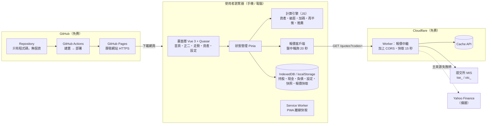

**設計重點**

| 項目 | 決策 | 原因 |
|------|------|------|
| 網頁主機 | GitHub Pages | 免費、HTTPS、不休眠；push 程式碼就自動部署 |
| 報價取得 | Cloudflare Worker 中繼 | 證交所 API 不允許瀏覽器跨網域呼叫；Worker 免費、不休眠、反應快 |
| 計算位置 | 瀏覽器 | 沒有後端；數字以 Excel 驗算值做單元測試 |
| 資料儲存 | 瀏覽器本機 | 免費、零個資外洩風險；缺點是不跨裝置同步（以 JSON 匯出入補足） |
| 提醒 | 頁面上的燈號＋選用瀏覽器通知 | Email / 簡訊需要伺服器保存資料與排程，延到完整版 |

> 與完整版差異：完整版的「後端代抓報價寫入 DB」→ 簡化版改為「Worker 即時代抓、不存」；完整版「後端計算為準」→ 簡化版「前端計算為準」。

---

## 2. 使用案例圖

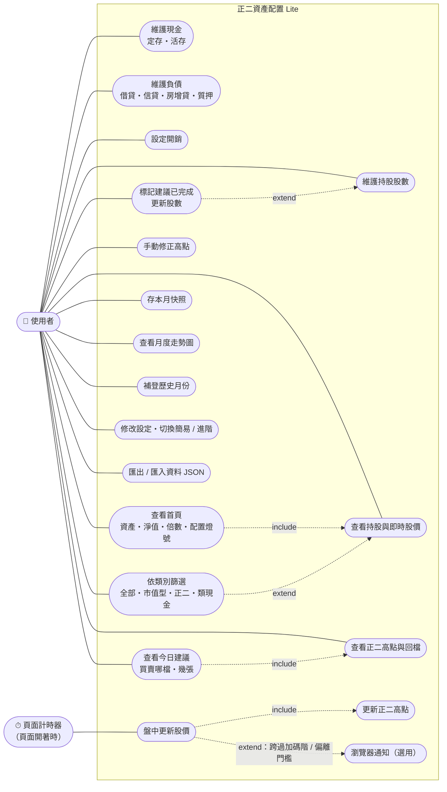

---

## 3. 類別圖

### 3.1 資料模型（存在瀏覽器）

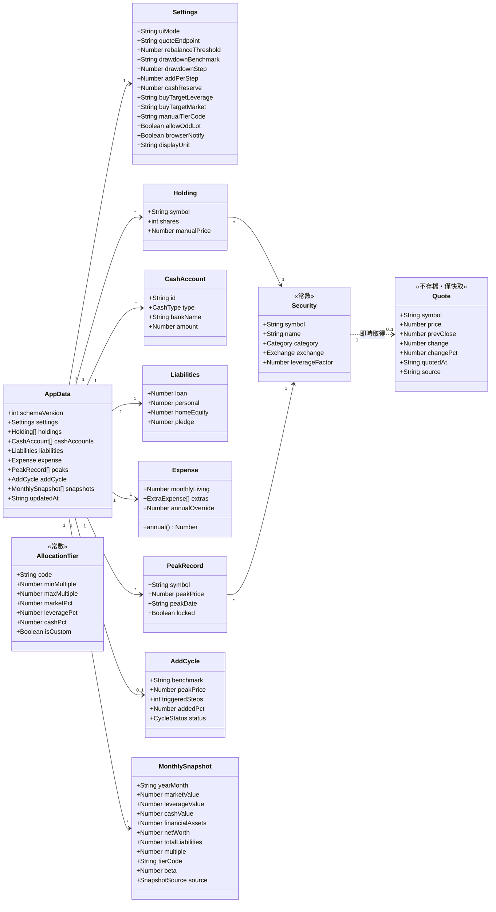

### 3.2 前端模組與計算引擎

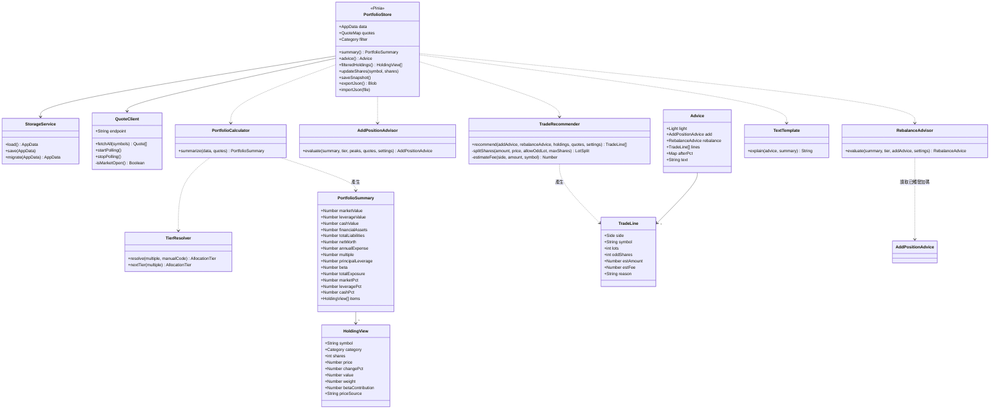

> 計算引擎（PortfolioCalculator、TierResolver、AddPositionAdvisor、RebalanceAdvisor、TradeRecommender）寫成**不依賴畫面的純函式**放在 `src/engine/`，方便單元測試，也方便日後改寫成 Java 時逐一對照。

### 3.3 列舉值

| 列舉 | 值 |
|------|------|
| Category | `MARKET` 市值型、`LEVERAGE` 槓桿正二、`CASH_LIKE` 類現金 |
| Exchange | `TSE` 上市、`OTC` 上櫃 |
| CashType | `DEMAND` 活存、`TIME_DEPOSIT` 定存 |
| SnapshotSource | `MANUAL` 手動存檔、`IMPORT` 補登 |
| CycleStatus | `ACTIVE`、`CAPPED`、`RECOVERING`、`CLOSED` |
| Light | `GREEN` 正常、`YELLOW` 可加碼、`RED` 需調整 |
| Side | `BUY`、`SELL` |
| PriceSource | `LIVE` 盤中、`CLOSE` 收盤、`CACHE` 快取、`MANUAL` 手動 |

---

## 4. 循序圖

### 4.1 開啟 App → 首頁

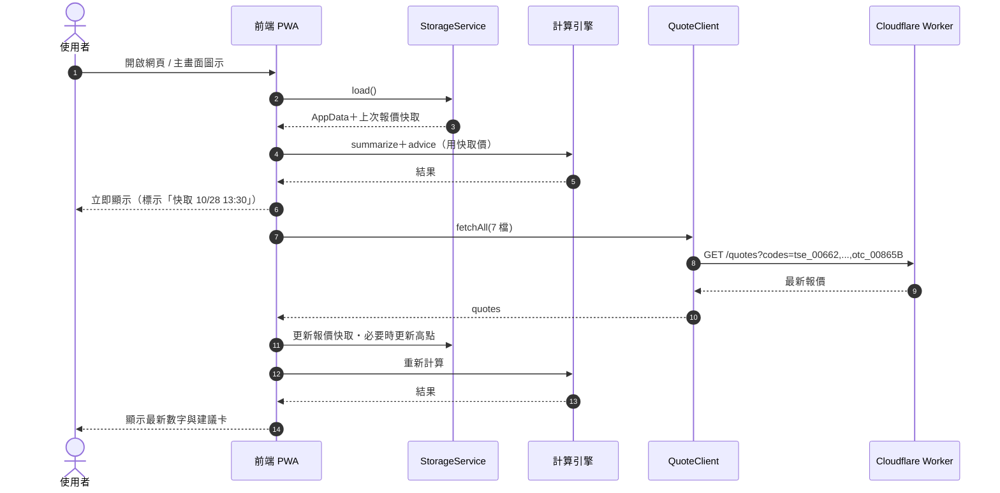

### 4.2 盤中報價輪詢

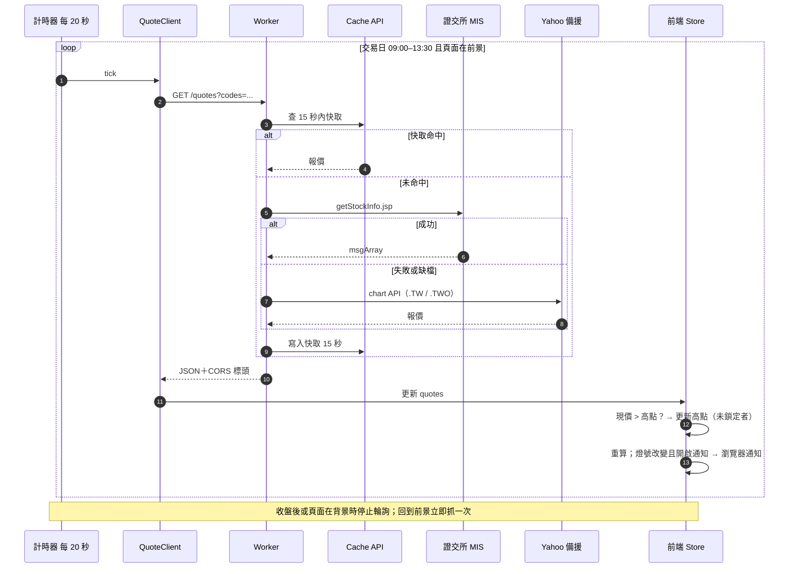

### 4.3 存月度快照 / 匯出匯入

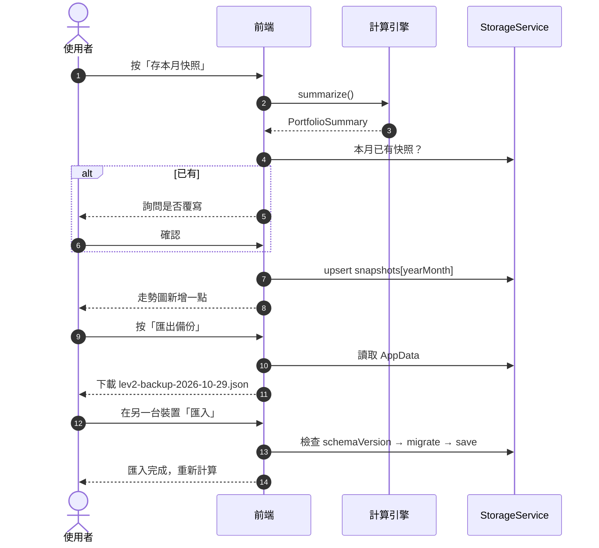

---

## 5. 流程圖

### 5.1 首次使用（建檔，簡易版）

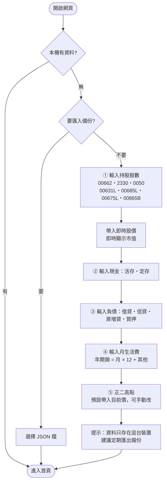

> 簡化版沒有近一年價格資料庫，高點無法自動回溯，第一次需手動輸入（或先以目前價為高點）。

### 5.2 計算主流程（與完整版相同）

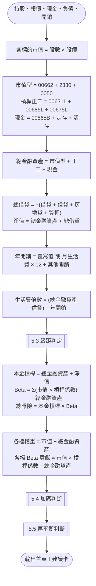

> 槓桿係數：市值型 1、正二 2、類現金與存款 0；因此 Σ(市值 × 係數) = 市值型 + 正二 × 2，與 Excel 一致。信貸以正數儲存，故倍數分子寫成「總金融資產 − 信貸」，等同 Excel 的「+ 信貸（負數）」。

### 5.3 級距判定

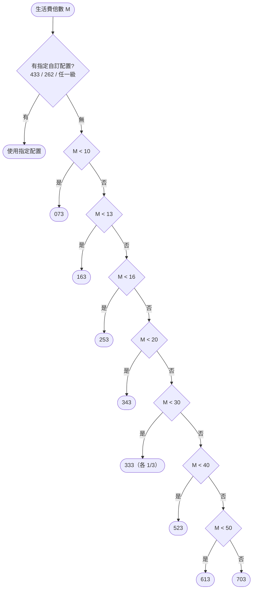

### 5.4 正二加碼判斷

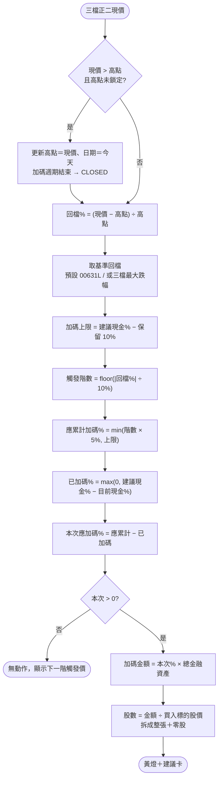

### 5.5 再平衡判斷與標的挑選

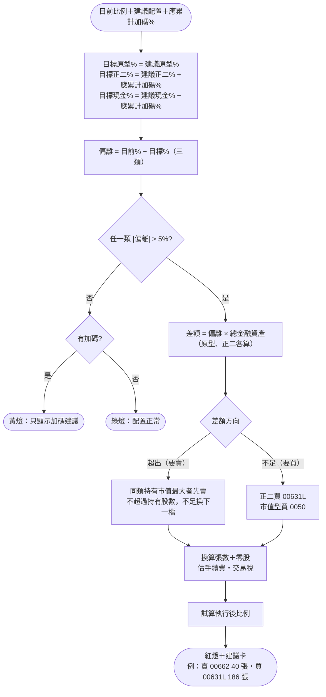

### 5.6 「我已完成」

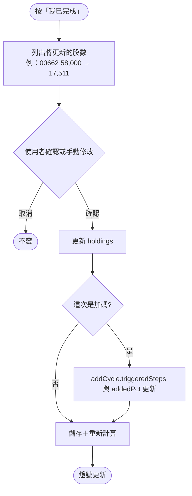

---

## 6. 狀態圖（正二加碼週期）

與完整版相同，狀態存在 `AppData.addCycle`。以 073（現金 30%、上限 20%）為例：

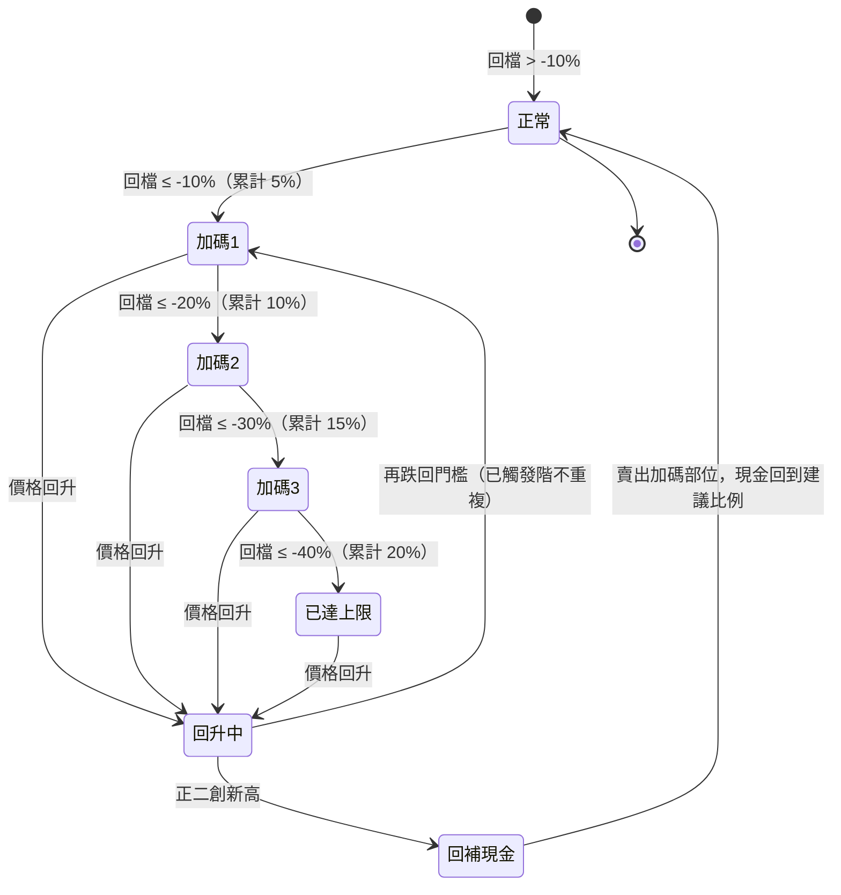

---

## 7. 資料設計（本機儲存）

### 7.1 儲存位置

| 資料 | 位置 | 說明 |
|------|------|------|
| AppData（持股、現金、負債、開銷、設定、高點、週期、快照） | IndexedDB（主）＋ localStorage（備） | 一個 JSON 文件，key：`lev2.appData` |
| 報價快取 | localStorage `lev2.quoteCache` | 離線或開啟瞬間先顯示 |
| 標的、級距表 | 程式常數 `src/engine/constants.js` | 不需使用者維護 |
| 備份 | 使用者下載的 JSON 檔 | 換裝置、換瀏覽器、清除資料前使用 |

> 單位：金額存**元**（Number，計算用 decimal.js 避免浮點誤差）；比例存小數（0.30 = 30%）；股數存「股」。

### 7.2 AppData JSON 結構（schemaVersion 1）

```json
{
  "schemaVersion": 1,
  "updatedAt": "2026-10-29T03:00:00Z",
  "settings": {
    "uiMode": "SIMPLE",
    "quoteEndpoint": "https://lev2-quotes.<帳號>.workers.dev",
    "rebalanceThreshold": 0.05,
    "drawdownBenchmark": "00631L",
    "drawdownStep": 0.10,
    "addPerStep": 0.05,
    "cashReserve": 0.10,
    "buyTargetLeverage": "00631L",
    "buyTargetMarket": "0050",
    "manualTierCode": null,
    "allowOddLot": true,
    "browserNotify": false,
    "displayUnit": "WAN"
  },
  "holdings": [
    { "symbol": "00662",  "shares": 58000,  "manualPrice": null },
    { "symbol": "00631L", "shares": 150000, "manualPrice": null },
    { "symbol": "00685L", "shares": 45000,  "manualPrice": null },
    { "symbol": "00865B", "shares": 100000, "manualPrice": null }
  ],
  "cashAccounts": [
    { "id": "c1", "type": "DEMAND", "bankName": "中信", "amount": 3000000 }
  ],
  "liabilities": { "loan": 0, "personal": 0, "homeEquity": 3000000, "pledge": 3000000 },
  "expense": {
    "monthlyLiving": 150000,
    "extras": [ { "name": "旅遊", "annualAmount": 100000 } ],
    "annualOverride": null
  },
  "peaks": [
    { "symbol": "00631L", "peakPrice": 41.32, "peakDate": "2026-07-15", "locked": false },
    { "symbol": "00685L", "peakPrice": null,  "peakDate": null, "locked": false },
    { "symbol": "00675L", "peakPrice": null,  "peakDate": null, "locked": false }
  ],
  "addCycle": { "benchmark": "00631L", "peakPrice": 41.32, "triggeredSteps": 0, "addedPct": 0, "status": "ACTIVE" },
  "snapshots": [
    { "yearMonth": "2026-09", "marketValue": 7197800, "leverageValue": 7227150, "cashValue": 7305000,
      "financialAssets": 21729950, "netWorth": 15729950, "totalLiabilities": -6000000,
      "multiple": 11.4368, "tierCode": "163", "beta": 0.9964, "source": "IMPORT" }
  ]
}
```

> 範例持股（00662 58,000 股 @124.10、00631L 150,000 股 @36.88、00685L 45,000 股 @37.67、00865B 100,000 股 @43.05、活存 300 萬）剛好算出第 0.3 節 Excel 驗算值，作為單元測試資料。股價為測試用假設值。

### 7.3 常數表

**標的**（同完整版 securities）

| symbol | name | category | exchange | leverageFactor |
|------|------|------|------|------|
| 00662 | 富邦NASDAQ | MARKET | TSE | 1 |
| 2330 | 台積電 | MARKET | TSE | 1 |
| 0050 | 元大台灣50 | MARKET | TSE | 1 |
| 00631L | 元大台灣50正2 | LEVERAGE | TSE | 2 |
| 00685L | 群益臺灣加權正2 | LEVERAGE | TSE | 2 |
| 00675L | 富邦臺灣加權正2 | LEVERAGE | TSE | 2 |
| 00865B | 國泰US短期公債 | CASH_LIKE | OTC | 0 |

> 上市 / 上櫃別決定報價代碼前綴（tse_ / otc_）；正式上線前請以證交所、櫃買中心查詢確認每檔的市場別。

**配置級距**：同完整版 7.2 allocation_tiers（073 … 703、433、262）。

### 7.4 資料版本與搬移

| 情況 | 處理 |
|------|------|
| 程式更新改了結構 | `schemaVersion` +1，`StorageService.migrate()` 逐版轉換 |
| 換手機 / 換瀏覽器 | 舊裝置匯出 JSON → 新裝置匯入 |
| 升級到完整版 | 完整版提供「匯入 Lite 備份」，JSON 欄位直接對應資料表（見第 14 節） |

### 7.5 資料安全

- GitHub repository **只放程式碼**，不放任何持股或金額
- Worker 只收到股票代號，不收到股數或金額
- 資料只在使用者瀏覽器；清除瀏覽器資料會一併刪除 → 首頁每 30 天提醒匯出備份
- 不放進網址參數；不使用第三方分析追蹤

---

## 8. 月度總資產走勢圖

| 項目 | 規格（與完整版差異以 ⚠️ 標示） |
|------|------|
| 資料來源 | `snapshots` ＋ 本月即時值（虛線點） |
| 建立方式 | ⚠️ 手動「存本月快照」或補登；不會自動月底存 |
| 圖型 | 折線圖（ECharts） |
| 主線 / 次線 | 總金融資產 / 淨值 |
| 可切換 | 市值型、正二、現金、總借貸（進階版） |
| 區間 | 6 個月 / 1 年 / 全部 |
| 提示框 | 金融資產、淨值、和上月差、倍數、當月配置 |
| 標記 | 配置級距變更月份 |
| 提醒 | ⚠️ 每月最後幾個交易日開啟時，首頁出現「記得存本月快照」 |

---

## 9. 畫面規劃

### 9.1 導覽

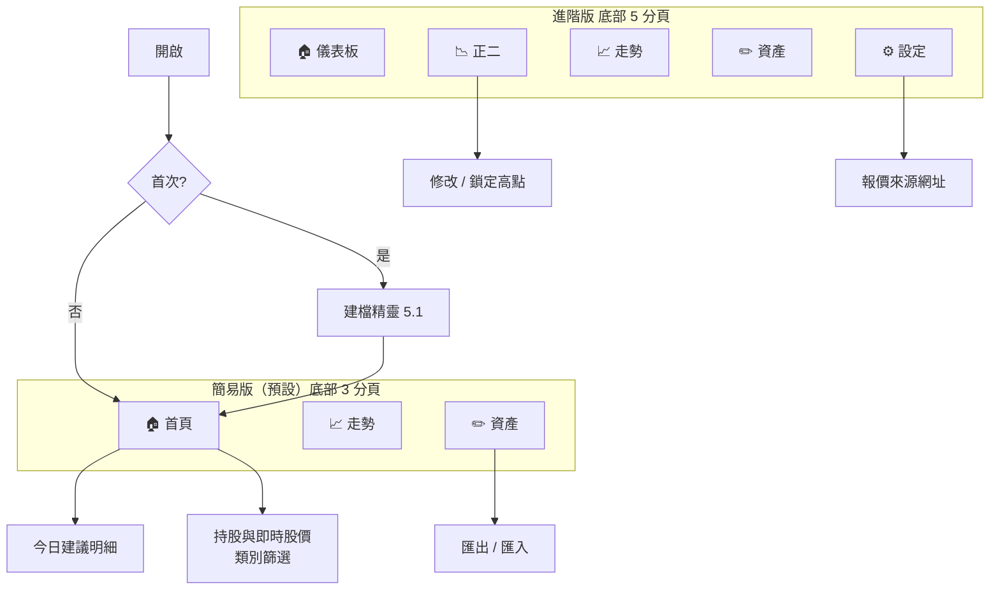

### 9.2 股價放在哪裡

| 位置 | 內容 | 理由 |
|------|------|------|
| **頁首右上** | 更新時間＋狀態（盤中 13:25:10 / 收盤 / 快取 / 失敗）＋手動刷新 | 一眼知道數字新不新 |
| **持股列表每一列** | 現價、漲跌、漲跌%，旁邊是市值、權重、Beta 貢獻 | 價格變動 → 權重偏移 → 要不要調整，在同一列看完 |
| 正二頁 | 現價、高點、回檔%、價格階梯 | 加碼判斷要的價格集中在這裡 |
| 建議卡 | 每一行「買 / 賣 標的 張數」附上使用的股價 | 下單前確認價格 |

台股慣例：**漲紅、跌綠**。

### 9.3 首頁（簡易版，手機線框）

```
┌────────────────────────────┐
│ 正二資產配置   ● 盤中 13:25:10 ⟳│
├────────────────────────────┤
│        總金融資產             │
│        2,173 萬              │
│  淨值 1,573 萬・借貸 -600 萬   │
├────────────────────────────┤
│ 生活費 11.4 倍 → 建議 163     │
│ Beta 1.00・總曝險 1.38        │
├────────────────────────────┤
│ 🔴 配置跑掉了，建議調整        │
│ 目前 原型33%・正二33%・現金34% │
│ 目標 原型10%・正二65%・現金25% │
├────────────────────────────┤
│ 💡 今天建議                   │
│ 賣 00662   40 張 489 股       │
│ 買 00631L 186 張 754 股       │
│ [我已完成]  [看更多 ›]        │
├────────────────────────────┤
│ 持股與即時股價                │
│ [全部][市值型][正二●][類現金]  │
│ 正二：持有 2 檔・723 萬・33%   │
│       Beta 貢獻 0.67          │
│ 00631L 元大台灣50正2           │
│  36.88 ▲0.52(+1.4%)  553 萬 25%│
│ 00685L 群益臺灣加權正2         │
│  37.67 ▼0.21(−0.6%)  170 萬  8%│
│ 未持有：00675L                │
└────────────────────────────┘
│   🏠 首頁   📈 走勢   ✏️ 資產  │
```

### 9.4 類別篩選規則（R27）

| 選擇 | 列表顯示 | 小計列 |
|------|------|------|
| 全部 | 所有持有標的，依市值排序 | 總金融資產、整體 Beta |
| 市值型 | 00662、2330、0050 中有持有者 | 合計市值、占比、Beta 貢獻 |
| **正二** | 00631L、00685L、00675L 中有持有者，附回檔% | 持有檔數、合計市值、占比、Beta 貢獻（= 正二占比 × 2） |
| 類現金 | 00865B＋定存、活存 | 現金合計、占比 |

- 未持有的同類標的收合成一行「未持有：…」，點開可直接輸入股數
- 篩選狀態記在本機，下次開啟維持

### 9.5 正二頁（進階版）

同完整版 9.3：每檔現價、高點（可編輯、可鎖定）、回檔%、第幾階、價格階梯（高點 × 0.9 / 0.8 / 0.7 / 0.6 / 0.5）、加碼進度條、下一階觸發價。

---

## 10. 報價 API（Cloudflare Worker）

### 10.1 介面

| 方法 | 路徑 | 說明 |
|------|------|------|
| GET | `/quotes?codes=tse_00662,tse_0050,otc_00865B` | 最多 30 檔；回傳最新報價 |
| GET | `/health` | 檢查 Worker 是否正常 |

**回應**

```json
{
  "fetchedAt": "2026-10-29T05:25:10Z",
  "quotes": {
    "00631L": { "price": 36.88, "prevClose": 36.36, "change": 0.52, "changePct": 0.0143,
                "quotedAt": "2026-10-29T05:25:05Z", "source": "TWSE" }
  },
  "errors": []
}
```

### 10.2 處理規則

| 規則 | 說明 |
|------|------|
| 主來源 | 證交所 MIS `getStockInfo.jsp`；成交價 `z` 為「-」時改用最佳買價，再退到昨收 |
| 備援 | 主來源失敗或缺檔時查 Yahoo（上市 `.TW`、上櫃 `.TWO`） |
| 快取 | Cache API 15 秒；多個裝置同時開也只打一次來源 |
| CORS | 只允許自己的 GitHub Pages 網域（環境變數 `ALLOWED_ORIGIN`） |
| 輸入檢查 | codes 只接受 `tse_`/`otc_` + 4–6 碼英數 |
| 不記錄 | 不存任何使用者資料，只轉送公開報價 |

### 10.3 前端輪詢規則

| 時段 | 行為 |
|------|------|
| 交易日 09:00–13:30，頁面在前景 | 每 20 秒 |
| 頁面切到背景 | 暫停；回前景立即抓一次 |
| 收盤後、假日 | 開啟時抓一次（取得收盤價），不輪詢 |
| 連續失敗 3 次 | 顯示「報價暫時無法更新」，改為每 60 秒重試 |

> 國定休市日：簡化版不另建休市日表，休市時來源回傳的就是前一交易日收盤價，畫面標示「收盤」。

---

## 11. 非功能需求

| 類別 | 需求 |
|------|------|
| 裝置 | 手機優先（≥ 360px）；iOS Safari、Android Chrome、桌機 Chrome / Edge |
| 安裝 | PWA，可加入主畫面 |
| 效能 | 開啟 1 秒內顯示快取；盤中報價延遲 ≤ 30 秒 |
| 離線 | 顯示最後資料與時間；可編輯，連線後重算 |
| 精度 | decimal.js 計算；顯示「萬」，可切「元 / 千元」 |
| 測試 | 計算引擎單元測試必須通過第 0.3 節驗算值（誤差 < 0.0001） |
| 安全 | HTTPS；個資只在本機；Worker 限制來源網域 |
| 備份 | 匯出 / 匯入 JSON；每 30 天提醒 |
| 免責 | 頁尾註明「試算工具，非投資建議」 |

---

## 12. 技術選型與免費額度

### 12.1 技術

| 層 | 技術 | 說明 |
|------|------|------|
| 前端 | **Vue 3 + Quasar（Vite）** | 與完整版相同，升級時畫面可沿用 |
| 狀態 | Pinia（＋ pinia-plugin-persistedstate） | 自動存回本機 |
| 本機資料 | IndexedDB（localForage） | |
| 圖表 | ECharts（vue-echarts） | |
| 金額計算 | decimal.js | |
| PWA | Quasar PWA 模式（Workbox） | |
| 測試 | Vitest | 計算引擎單元測試 |
| 報價中繼 | Cloudflare Workers（JavaScript） | |
| 部署 | GitHub Actions → GitHub Pages；Wrangler → Workers | |

> 若想再更簡單：前端也可以先做成「單一 HTML 檔＋原生 JavaScript」，不需建置；但之後要升級完整版時畫面需重寫。建議直接用 Vue 3 + Quasar。

### 12.2 免費平台比較

| 平台 | 用途 | 免費方案重點 | 是否休眠 |
|------|------|------|------|
| GitHub Pages | 網站 | 免費帳號需公開 repository（程式碼公開、資料不在裡面） | 不休眠 |
| Cloudflare Workers | 報價中繼 | 每日請求數有上限（約 10 萬次） | 不休眠 |
| Cloudflare Pages | 網站（替代 GitHub Pages） | 可用私人 repository | 不休眠 |

**用量估算（一人、兩台裝置）**：盤中 4.5 小時 × 每分鐘 3 次 × 2 台 ≈ 1,620 次 / 日，遠低於上限。

> 免費額度可能調整，上線前請至各平台官網確認。若希望程式碼也不公開，網站改放 Cloudflare Pages 即可，其餘不變。

### 12.3 專案結構

```
lev2-lite/
├─ web/                      # 前端（GitHub Pages）
│  ├─ src/
│  │  ├─ engine/             # 計算引擎（純函式）
│  │  │  ├─ constants.js     # 標的、級距
│  │  │  ├─ calculator.js    # PortfolioCalculator
│  │  │  ├─ tier.js          # TierResolver
│  │  │  ├─ addPosition.js   # AddPositionAdvisor
│  │  │  ├─ rebalance.js     # RebalanceAdvisor
│  │  │  └─ recommender.js   # TradeRecommender
│  │  ├─ services/           # StorageService、QuoteClient
│  │  ├─ stores/portfolio.js # Pinia
│  │  ├─ pages/              # Home、Leverage、Chart、Assets、Settings
│  │  └─ components/         # HoldingList、CategoryChips、AllocationBar、AdviceCard…
│  └─ test/engine.spec.js    # Excel 驗算測試
├─ worker/                   # Cloudflare Worker
│  ├─ src/index.js
│  └─ wrangler.toml
└─ .github/workflows/deploy.yml
```

---

## 13. 部署流程

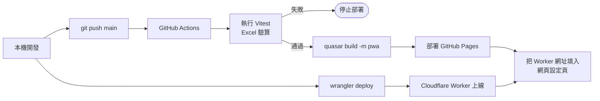

**步驟**

1. 建立 GitHub repository `lev2-lite`，開啟 Pages（來源：GitHub Actions）
2. 註冊 Cloudflare（免費），`wrangler deploy` 部署 `worker/`，設定 `ALLOWED_ORIGIN=https://<帳號>.github.io`
3. push 程式碼，Actions 自動測試＋部署
4. 手機開啟網址 →「加入主畫面」→ 設定頁填入 Worker 網址 → 建檔

---

## 14. 升級到完整版的路徑

| 階段 | 加入內容 | 平台 | 對應完整版 |
|------|------|------|------|
| Lite（本文件） | 計算、即時股價、正二篩選、建議、手動快照 | GitHub Pages + Worker | R01–R21、R25 |
| Lite+ 1 | 雲端同步（跨裝置）、登入 | Cloudflare D1 或 Neon + Worker | R20、R26 |
| Lite+ 2 | 盤中排程＋Email 提醒、月底自動快照 | Worker Cron Triggers＋Email 寄送商 | R19、R23（Email） |
| 完整版 | Spring Boot 後端、簡訊、AI 說明 | 依完整版 15 節 | R22–R24 |

**可沿用的部分**

| 項目 | 沿用方式 |
|------|------|
| 畫面 | Vue 3 + Quasar 元件直接沿用，資料來源從本機改為 API |
| 計算引擎 | JS 版留作前端預覽；Java 版以同一組 Excel 驗算測試對照改寫 |
| 資料 | AppData JSON → 完整版資料表一對一對應（holdings、cash_accounts、liabilities、expense_profiles、peak_records、add_position_cycles、monthly_snapshots） |
| 報價 Worker | 可繼續當完整版的報價來源之一 |

**AppData → 完整版資料表對應**

| AppData | 完整版資料表 |
|------|------|
| settings | user_settings |
| holdings[] | holdings |
| cashAccounts[] | cash_accounts |
| liabilities.{loan, personal, homeEquity, pledge} | liabilities（各一筆，type = LOAN / PERSONAL / HOME_EQUITY / PLEDGE） |
| expense / extras | expense_profiles / extra_expenses |
| peaks[] | peak_records（locked → is_manual） |
| addCycle | add_position_cycles |
| snapshots[] | monthly_snapshots |
