# 正二資產配置系統 — 系統設計稿 v1.1

> 依據：使用者需求（本文件第 0 節完整收錄）＋「阿良的正二人生 資產負債表 範本.xlsx」公式
> 範圍：需求總覽、系統架構、UML、流程圖、資料庫設計、月度資產走勢圖、畫面規劃、API 清單、技術選型
> 圖表格式：Mermaid（GitHub、VS Code、Notion、Obsidian 可直接顯示）
> 狀態：設計階段，尚未撰寫程式

### 版本紀錄

| 版本 | 日期 | 內容 |
|------|------|------|
| v0.1 | 2026-10-29 | 初版需求整理 |
| v0.2 | 2026-10-29 | 依 Excel 確認公式；確認 9 項待確認事項 |
| v1.0 | 2026-10-29 | UML、流程圖、DB 設計、月度走勢圖 |
| v1.0+ | 2026-10-29 | 追加：簡易版 / 進階版介面、AI 加減碼推薦（標的＋股數） |
| v1.0+ | 2026-10-29 | 追加：配置提醒改用 Email / 簡訊寄送 |
| v1.1 | 2026-10-29 | 收錄全部需求；技術選型（Spring Boot、Vue 3 + Quasar、Neon）；計算引擎改由後端為準 |

---

## 目錄

0. 需求總覽（使用者需求完整紀錄）
1. 系統架構
2. 使用案例圖
3. 類別圖（領域模型＋計算服務）
4. 循序圖
5. 流程圖
6. 狀態圖（正二加碼週期）
7. 資料庫設計（ER 圖＋資料表規格）
8. 月度總資產走勢圖設計
9. 畫面規劃與導覽
10. API 清單
11. 非功能需求
12. 介面模式：簡易版 / 進階版
13. AI 加減碼推薦（推薦標的＋股數）
14. 配置提醒：Email / 簡訊
15. 技術選型

---

## 0. 需求總覽（使用者需求完整紀錄）

### 0.1 產品目標

做一個**網頁與手機都能用**的資產配置工具：使用者輸入持股與負債，系統自動抓股價，算出資產結構、生活費倍數、建議配置（原型／正二／現金）、槓桿曝險，並在正二回檔或配置跑掉時，**推薦要買／賣哪幾檔、多少股數**，以 Email 或簡訊提醒。

### 0.2 功能需求清單

| 編號 | 需求 | 使用者原始要求 | 對應章節 |
|------|------|------|------|
| R01 | 持股輸入 | 使用者一開始輸入有哪些股票；**輸入股數**，系統帶出股價算市值 | 5.1、7.2 holdings |
| R02 | 負債輸入 | 輸入借貸、信貸、房增貸、質押各多少（原需求中「信貸」重複輸入，合併為一項） | 5.1、7.2 liabilities |
| R03 | 標的分類 | 00662、2330、0050 → 市值型；00631L、00685L、00675L → 槓桿正二；00865B → 類現金 | 7.2 securities |
| R04 | 現金定義 | 現金 = 類現金（00865B）+ 定存 + 活存現金 | 5.2 |
| R05 | 三大類 | 資產分三類：現金、槓桿正二、市值型；三者相加為**總金融資產** | 5.2 |
| R06 | 總借貸 | 總借貸（負數）= 借貸 + 信貸 + 房增貸 + 質押 | 5.2 |
| R07 | 年開銷 | 輸入每月生活費，算出年開銷；旅遊等其他開銷讓使用者依情境自行修改年開銷 | 5.1、7.2 expense |
| R08 | 生活費倍數 | 金融資產 ÷ 年花費 = 幾倍生活費；依 Excel：(總金融資產 + 信貸) ÷ 年開銷 | 5.2 |
| R09 | 配置建議 | 依倍數對應 073 / 163 / 253 / 343 / 333 / 523 / 613 / 703（原型／正二／現金）；333 依 Excel 為三等分 | 5.3、7.2 tiers |
| R10 | 淨值 | 總資產淨值 = 市值型 + 槓桿正二 + 現金 + 總借貸 | 5.2 |
| R11 | 本金槓桿 | 依 Excel：總金融資產 ÷ 淨值 | 5.2 |
| R12 | 曝險(Beta) | 市值型 + 槓桿正二 × 2；依 Excel 再除以總金融資產得比例 | 5.2 |
| R13 | 總曝險 | 本金槓桿 × 曝險(Beta) | 5.2 |
| R14 | 股價顯示 | 顯示 00662、2330、0050、00631L、00685L、00675L、00865B 股價 | 4.2、6 |
| R15 | 正二高點紀錄 | 紀錄 00631L、00685L、00675L **三檔**最高價 | 5.4、7.2 peaks |
| R16 | 加碼規則 | 依剩下現金% 算加碼%：073 現金 30% → 預計加碼 20%、留 10%，其他類推；正二每跌 10% 加碼 5%，最多加到 20% | 5.4、6 |
| R17 | 即時比例 | 即時換算目前（原型／正二／現金）比例 | 5.2 |
| R18 | 超出配置提醒 | 告知使用者目前已超過，建議**賣出哪幾檔補現金**，或**補正二及市值型** | 5.5 |
| R19 | 月度走勢圖 | 每個月的總資產線性圖 | 8 |
| R20 | 跨裝置 | 網頁及手機都可以用 | 1、11 |
| R21 | 好操作、簡易優先 | 介面要好操作；有簡略版本跟複雜資訊，但使用者只想看到簡單的介面 → **預設簡易版** | 12 |
| R22 | AI 加減碼推薦 | 依使用者目前持有的資產，推薦可以投資哪幾檔、需要多少股數 | 13 |
| R23 | 配置提醒寄送 | 配置提醒用 **Email 或簡訊**寄出 | 14 |
| R24 | 後端 | Spring Boot | 15 |
| R25 | 前端 | Vue（採 Vue 3 + Quasar） | 15 |
| R26 | 資料庫 | 免費 DB（採 Neon PostgreSQL） | 15 |

### 0.3 已確認事項

| # | 問題 | 決定 |
|------|------|------|
| 1 | 信貸重複 | 重複輸入，負債為：借貸、信貸、房增貸、質押 |
| 2 | 輸入方式 | 輸入股數，自動帶股價算市值 |
| 3 | 生活費倍數分子 | 依 Excel：總金融資產 + 信貸（負數）；房增貸、質押不扣 |
| 4 | 333 | 依 Excel：三等分 |
| 5 | 槓桿公式 | 依 Excel：本金槓桿 = 總金融資產 ÷ 淨值；Beta = (市值型 + 正二×2) ÷ 總金融資產；總曝險 = 本金槓桿 × Beta |
| 6 | 高點追蹤 | 00675L、00685L、00631L 三檔都要 |
| 7 | 超出配置 | 告知賣哪幾檔補現金，或買哪幾檔補正二／市值型 |
| 8 | 865b | 即 00865B 國泰 US 短期公債 |
| 9 | 形式 | 網頁＋手機（PWA） |

### 0.4 Excel 驗算基準（2026/09）

系統計算結果必須與下表一致（單位：千元），作為前後端共用測試案例。

| 項目 | 值 |
|------|------|
| 市值型 | 7,197.80 |
| 槓桿正二 | 7,227.15 |
| 現金 | 7,305.00 |
| 總金融資產 | 21,729.95 |
| 總借貸 | −6,000.00 |
| 淨值 | 15,729.95 |
| 年花費 | 1,900 |
| 幾倍年生活費 | 11.4368 → 163 |
| 本金槓桿 | 1.3814 |
| 曝險(Beta) | 0.9964 |
| 總曝險 | 1.3765 |

### 0.5 採預設、可在設定修改的參數

| 參數 | 預設 |
|------|------|
| 加碼回檔基準 | 00631L（可改其他檔或「三檔最大跌幅」） |
| 加碼步距 / 每步加碼 / 保留現金 | 10% / 5% / 10% |
| 再平衡門檻 | ±5 個百分點 |
| 賣出順序 | 同類別持有市值最大者先賣 |
| 買入標的 | 正二 00631L、市值型 0050；2330 預設不推薦買入 |
| 推薦拆檔門檻 | 金額 ≥ 300 萬拆成最多 2 檔 |
| 零股 | 允許 |
| 正二漲回新高 | 加碼部位賣回，現金回到建議比例 |
| 介面模式 | 簡易版 |
| 提醒 | Email 全部類型；簡訊只開加碼、再平衡，每日上限 3 則；勿擾 22:00–08:00 |

### 0.6 Excel 中有、本系統一併納入

| 項目 | 說明 |
|------|------|
| 和上個月差 | 月度快照計算 |
| 線圖分頁 | 月度走勢圖 |
| 自訂配置 433、262 | 設定中可手動選用 |
| 各配置 5 年報酬推算年化 | 配置表旁顯示參考 |
| 正二價格階梯 | 高點 × 0.9 / 0.8 / 0.7 / 0.6 / 0.5 |

---

## 1. 系統架構

採 **PWA（Progressive Web App）**：同一套前端，電腦用瀏覽器開，手機「加入主畫面」即像 App。
後端 **Spring Boot**、前端 **Vue 3 + Quasar**、資料庫 **Neon PostgreSQL**（詳見第 15 節）。

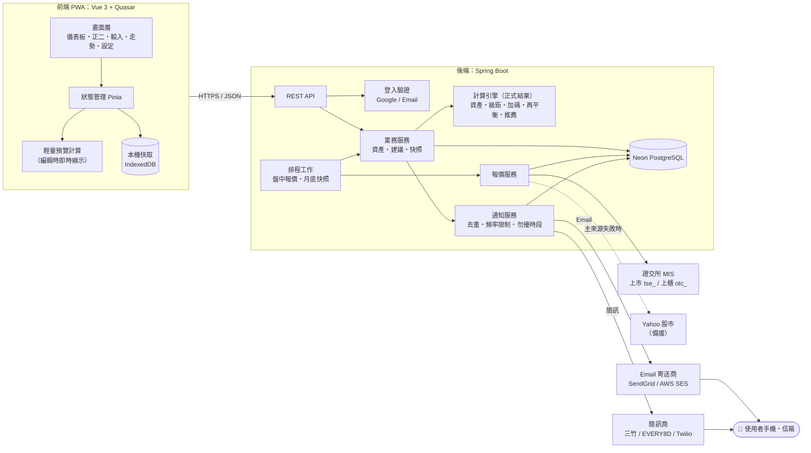

**設計重點**

| 項目 | 決策 | 原因 |
|------|------|------|
| 報價取得 | 後端代抓、寫入 DB，前端讀 DB | 證交所 API 不允許瀏覽器跨網域呼叫；多使用者共用同一份報價，減少請求 |
| 計算引擎 | **後端為準**；前端只做編輯中的輕量預覽 | 後端 Java、前端 JS 無法共用程式；所有正式數字（儀表板、快照、推薦、提醒）都由後端算。兩邊以第 0.4 節 Excel 驗算值作為共同測試案例，確保一致 |
| 離線 | IndexedDB 快取最後資料 | 手機沒網路仍可看最後一次數字 |
| 配置提醒 | **Email 或簡訊**（使用者自選，可兩者都開） | 不用開 App 也收得到；詳見第 14 節 |

---

## 2. 使用案例圖

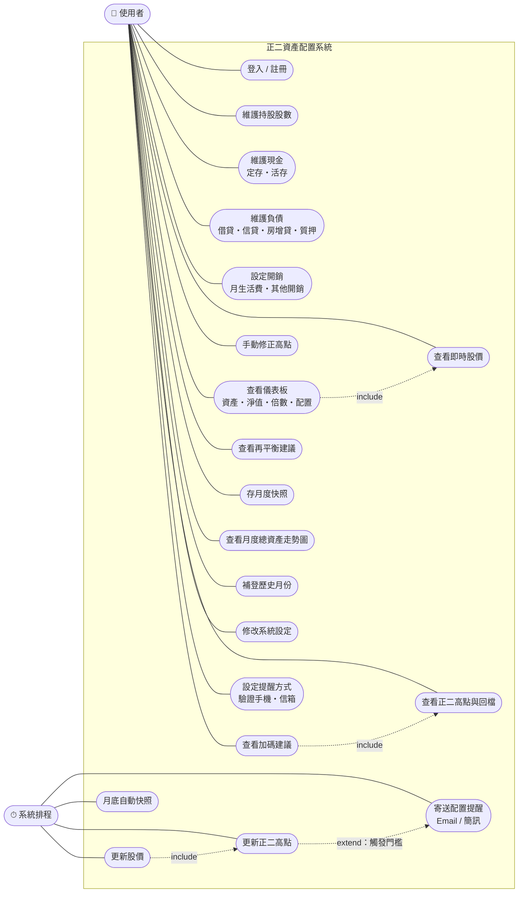

---

## 3. 類別圖

### 3.1 領域模型

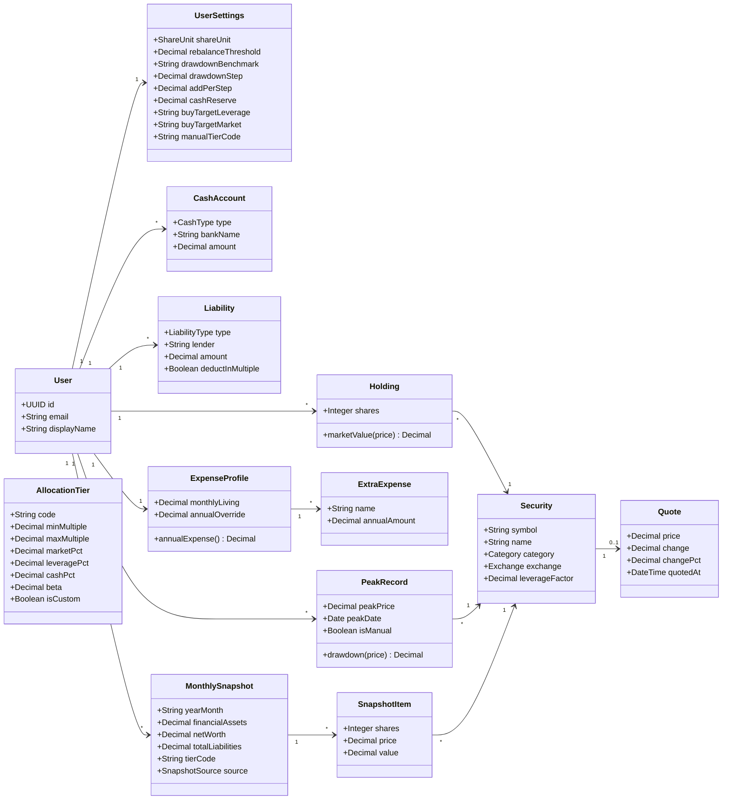

### 3.2 計算服務與結果物件

```mermaid
classDiagram
    direction TB

    class PortfolioCalculator {
        +summarize(holdings, quotes, cash, liabilities, expense) PortfolioSummary
    }

    class TierResolver {
        +resolve(multiple, tiers, manualCode) AllocationTier
    }

    class AddPositionAdvisor {
        +evaluate(summary, tier, peaks, quotes, settings) AddPositionAdvice
    }

    class RebalanceAdvisor {
        +evaluate(summary, tier, addAdvice, holdings, quotes, settings) RebalanceAdvice
    }

    class TradeRecommender {
        +recommend(addAdvice, rebalanceAdvice, holdings, quotes, settings) TradeRecommendation
        -pickSymbols(category, side, holdings) Security[]
        -splitShares(amount, price, allowOddLot) LotSplit
        -estimateFee(side, amount, symbol) Decimal
    }

    class AIExplainer {
        +explain(recommendation, summary) String
    }

    class TradeRecommendation {
        +TriggerType triggerType
        +Decimal totalAmount
        +RecommendationLine[] lines
        +String aiSummary
    }

    class RecommendationLine {
        +Side side
        +String symbol
        +Integer lots
        +Integer oddShares
        +Decimal estAmount
        +Decimal estFee
        +String reason
    }

    TradeRecommender ..> AddPositionAdvice : 讀取金額
    TradeRecommender ..> RebalanceAdvice : 讀取金額
    TradeRecommender ..> TradeRecommendation : 產生
    AIExplainer ..> TradeRecommendation : 補白話說明
    TradeRecommendation --> "*" RecommendationLine

    class SnapshotService {
        +create(userId, yearMonth, source) MonthlySnapshot
        +history(userId, range) MonthlySnapshot[]
    }

    class QuoteService {
        +fetchAll() Quote[]
        +updatePeaks(quotes) PeakRecord[]
    }

    class PortfolioSummary {
        +Decimal marketValue
        +Decimal leverageValue
        +Decimal cashValue
        +Decimal financialAssets
        +Decimal totalLiabilities
        +Decimal netWorth
        +Decimal annualExpense
        +Decimal multiple
        +Decimal principalLeverage
        +Decimal exposureAmount
        +Decimal beta
        +Decimal totalExposure
        +Decimal marketPct
        +Decimal leveragePct
        +Decimal cashPct
    }

    class AddPositionAdvice {
        +String benchmark
        +Decimal drawdown
        +Decimal capPct
        +Decimal targetAddedPct
        +Decimal alreadyAddedPct
        +Decimal addNowPct
        +Decimal addNowAmount
        +TradeSuggestion trade
    }

    class RebalanceAdvice {
        +Decimal targetMarketPct
        +Decimal targetLeveragePct
        +Decimal targetCashPct
        +Boolean outOfRange
        +Boolean tierChanged
        +TradeSuggestion[] trades
    }

    class TradeSuggestion {
        +Side side
        +String symbol
        +Decimal amount
        +Integer shares
        +String reason
    }

    PortfolioCalculator ..> PortfolioSummary : 產生
    TierResolver ..> PortfolioSummary : 讀取倍數
    AddPositionAdvisor ..> AddPositionAdvice : 產生
    RebalanceAdvisor ..> RebalanceAdvice : 產生
    RebalanceAdvisor ..> AddPositionAdvice : 讀取已觸發加碼
    AddPositionAdvice --> TradeSuggestion
    RebalanceAdvice --> "*" TradeSuggestion
    SnapshotService ..> PortfolioCalculator : 使用
```

### 3.3 列舉值

| 列舉 | 值 |
|------|------|
| Category | `MARKET` 市值型、`LEVERAGE` 槓桿正二、`CASH_LIKE` 類現金 |
| Exchange | `TSE` 上市、`OTC` 上櫃 |
| CashType | `DEMAND` 活存、`TIME_DEPOSIT` 定存 |
| LiabilityType | `LOAN` 借貸、`PERSONAL` 信貸、`HOME_EQUITY` 房增貸、`PLEDGE` 質押 |
| ShareUnit | `SHARE` 股、`LOT` 張 |
| SnapshotSource | `AUTO` 月底自動、`MANUAL` 手動存檔、`IMPORT` 補登 |
| Side | `BUY`、`SELL` |

---

## 4. 循序圖

### 4.1 開啟 App → 儀表板

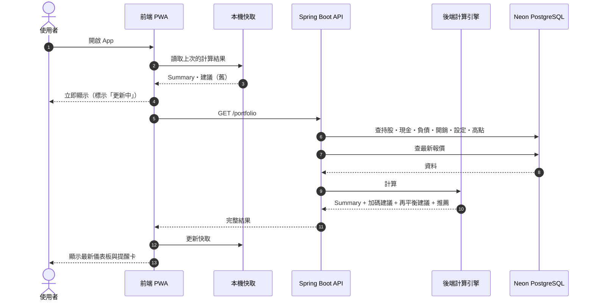

### 4.2 盤中報價更新（每分鐘）

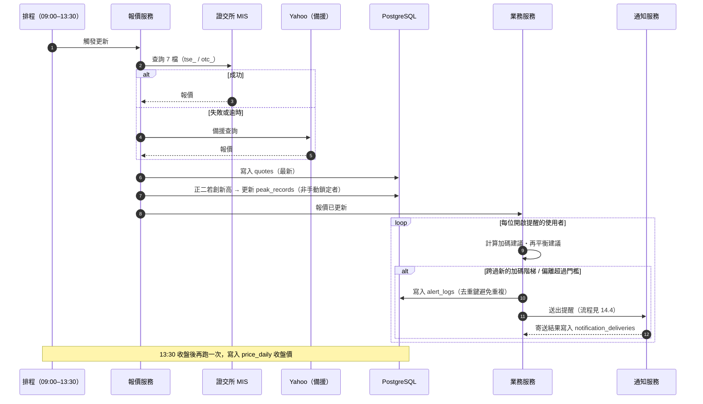

### 4.3 月度快照

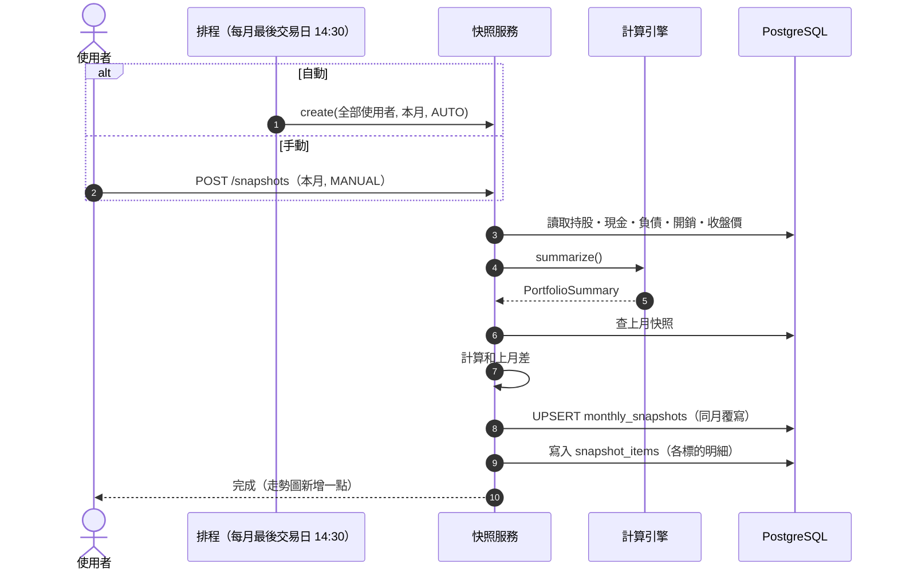

---

## 5. 流程圖

### 5.1 首次使用（建檔）

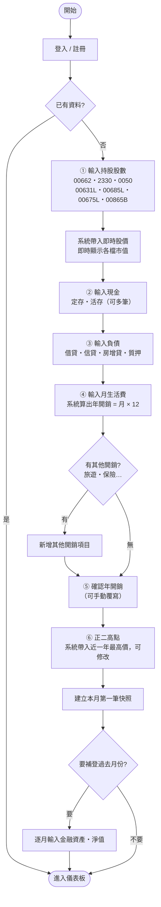

### 5.2 儀表板計算主流程

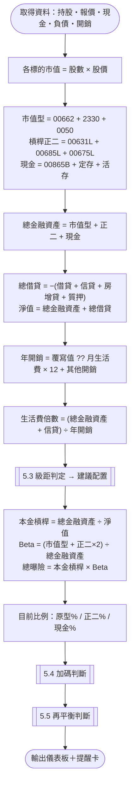

### 5.3 級距判定

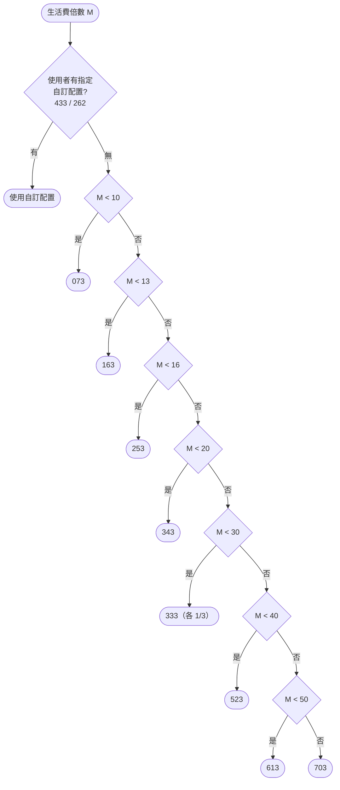

### 5.4 正二加碼判斷

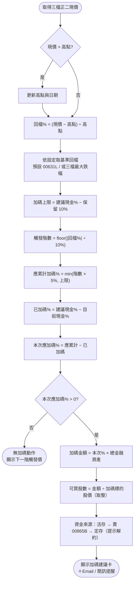

### 5.5 再平衡判斷與標的挑選

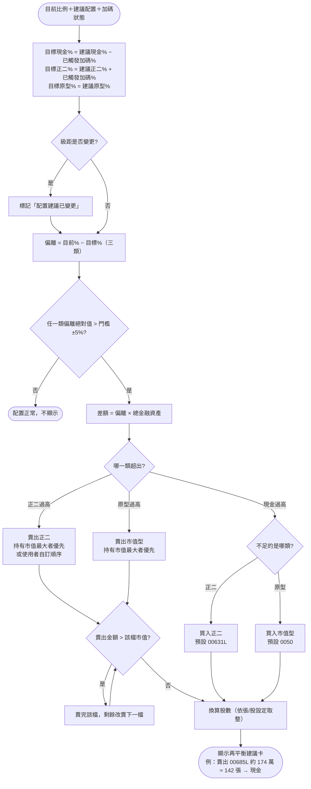

### 5.6 月度快照流程

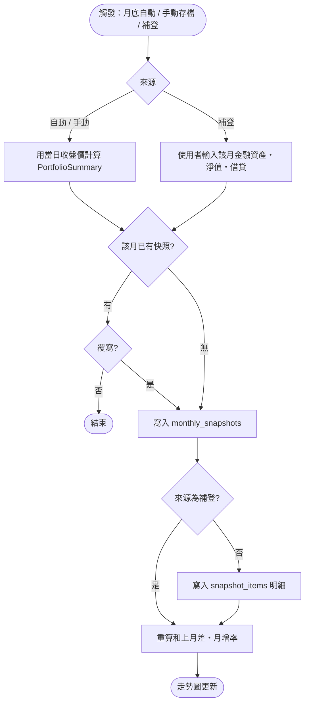

---

## 6. 狀態圖（正二加碼週期）

以 073（現金 30%、上限 20%）為例：

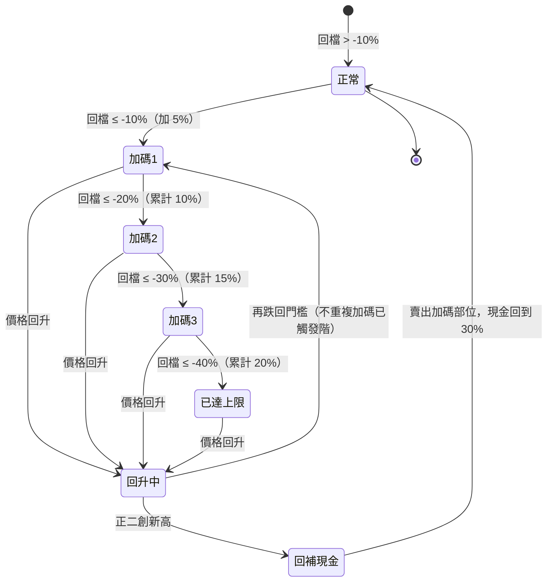

> 已觸發的階數記在 `add_position_cycles`，回升後再跌回同一階不重複加碼；新高後週期結束，進入回補。

---

## 7. 資料庫設計

### 7.1 ER 圖

```mermaid
erDiagram
    users ||--|| user_settings : has
    users ||--o{ holdings : owns
    users ||--o{ cash_accounts : owns
    users ||--o{ liabilities : owes
    users ||--|| expense_profiles : has
    expense_profiles ||--o{ extra_expenses : includes
    users ||--o{ peak_records : tracks
    users ||--o{ monthly_snapshots : records
    users ||--o{ add_position_cycles : runs
    users ||--o{ alert_logs : receives
    users ||--o{ notification_channels : "notify via"
    alert_logs ||--o{ notification_deliveries : "sent as"
    notification_channels ||--o{ notification_deliveries : "delivered to"
    users ||--o{ trade_recommendations : receives
    trade_recommendations ||--o{ recommendation_lines : contains
    securities ||--o{ recommendation_lines : "recommended"
    monthly_snapshots ||--o{ snapshot_items : details
    securities ||--o{ holdings : "held as"
    securities ||--|| quotes : "latest price"
    securities ||--o{ price_daily : "daily close"
    securities ||--o{ peak_records : "peak of"
    securities ||--o{ snapshot_items : "item of"
    allocation_tiers ||--o{ monthly_snapshots : "tier at"

    users {
        uuid id PK
        varchar email UK
        varchar display_name
        varchar auth_provider
        timestamptz created_at
    }
    user_settings {
        uuid user_id PK,FK
        varchar share_unit
        numeric rebalance_threshold
        varchar drawdown_benchmark
        numeric drawdown_step
        numeric add_per_step
        numeric cash_reserve
        varchar buy_target_leverage
        varchar buy_target_market
        varchar cash_destination
        varchar manual_tier_code FK
        jsonb sell_priority
        boolean notify_enabled
        time quiet_start
        time quiet_end
        int sms_daily_limit
        varchar ui_mode
        boolean allow_odd_lot
        boolean ai_explain_enabled
    }
    securities {
        varchar symbol PK
        varchar name
        varchar category
        varchar exchange
        numeric leverage_factor
        numeric five_year_return
        boolean is_active
    }
    holdings {
        uuid id PK
        uuid user_id FK
        varchar symbol FK
        int shares
        timestamptz updated_at
    }
    cash_accounts {
        uuid id PK
        uuid user_id FK
        varchar type
        varchar bank_name
        numeric amount
        varchar note
    }
    liabilities {
        uuid id PK
        uuid user_id FK
        varchar type
        varchar lender
        numeric amount
        boolean deduct_in_multiple
    }
    expense_profiles {
        uuid user_id PK,FK
        numeric monthly_living
        numeric annual_override
    }
    extra_expenses {
        uuid id PK
        uuid user_id FK
        varchar name
        numeric annual_amount
    }
    allocation_tiers {
        varchar code PK
        numeric min_multiple
        numeric max_multiple
        numeric market_pct
        numeric leverage_pct
        numeric cash_pct
        numeric beta
        boolean is_custom
        int sort_order
    }
    quotes {
        varchar symbol PK,FK
        numeric price
        numeric change
        numeric change_pct
        varchar source
        timestamptz quoted_at
    }
    price_daily {
        varchar symbol PK,FK
        date trade_date PK
        numeric open
        numeric high
        numeric low
        numeric close
    }
    peak_records {
        uuid id PK
        uuid user_id FK
        varchar symbol FK
        numeric peak_price
        date peak_date
        boolean is_manual
        timestamptz updated_at
    }
    add_position_cycles {
        uuid id PK
        uuid user_id FK
        varchar benchmark
        numeric peak_price
        int triggered_steps
        numeric added_pct
        varchar status
        timestamptz started_at
        timestamptz ended_at
    }
    monthly_snapshots {
        uuid id PK
        uuid user_id FK
        char year_month
        numeric market_value
        numeric leverage_value
        numeric cash_value
        numeric financial_assets
        numeric total_liabilities
        numeric net_worth
        numeric annual_expense
        numeric multiple
        varchar tier_code FK
        numeric principal_leverage
        numeric beta
        numeric total_exposure
        numeric mom_change
        varchar source
        timestamptz created_at
    }
    snapshot_items {
        uuid snapshot_id PK,FK
        varchar symbol PK,FK
        int shares
        numeric price
        numeric value
    }
    alert_logs {
        uuid id PK
        uuid user_id FK
        varchar alert_type
        varchar alert_key
        jsonb payload
        boolean is_read
        timestamptz created_at
    }
    notification_channels {
        uuid id PK
        uuid user_id FK
        varchar channel
        varchar address
        boolean is_verified
        boolean is_enabled
        jsonb alert_types
        timestamptz verified_at
    }
    notification_deliveries {
        uuid id PK
        uuid alert_id FK
        uuid channel_id FK
        varchar status
        varchar provider_msg_id
        int retry_count
        text error_message
        timestamptz sent_at
    }
    trade_recommendations {
        uuid id PK
        uuid user_id FK
        varchar trigger_type
        jsonb input_snapshot
        numeric total_amount
        text ai_summary
        varchar status
        timestamptz created_at
        timestamptz executed_at
    }
    recommendation_lines {
        uuid id PK
        uuid recommendation_id FK
        varchar symbol FK
        varchar side
        int lots
        int odd_shares
        numeric est_price
        numeric est_amount
        numeric est_fee
        text reason
        int sort_order
    }
```

### 7.2 資料表規格

金額單位：**元**，`NUMERIC(16,2)`；股價 `NUMERIC(10,2)`；比例 `NUMERIC(6,4)`（0.3000 = 30%）；股數 `INTEGER`（一律存「股」，張只是顯示）；時間一律 `TIMESTAMPTZ`，顯示時轉 Asia/Taipei。

#### users — 使用者

| 欄位 | 型別 | 約束 | 說明 |
|------|------|------|------|
| id | UUID | PK | |
| email | VARCHAR(255) | UNIQUE, NOT NULL | |
| display_name | VARCHAR(100) | | |
| auth_provider | VARCHAR(20) | | google / email |
| created_at | TIMESTAMPTZ | DEFAULT now() | |

#### user_settings — 使用者設定

| 欄位 | 型別 | 預設 | 說明 |
|------|------|------|------|
| user_id | UUID | PK, FK→users | |
| share_unit | VARCHAR(10) | `SHARE` | SHARE 股 / LOT 張（顯示用） |
| rebalance_threshold | NUMERIC(6,4) | 0.0500 | 再平衡門檻 ±5% |
| drawdown_benchmark | VARCHAR(10) | `00631L` | 加碼回檔基準；`MAX` = 三檔最大跌幅 |
| drawdown_step | NUMERIC(6,4) | 0.1000 | 每回檔 10% 一階 |
| add_per_step | NUMERIC(6,4) | 0.0500 | 每階加碼 5% |
| cash_reserve | NUMERIC(6,4) | 0.1000 | 保留現金 10% |
| buy_target_leverage | VARCHAR(10) | `00631L` | 正二買入標的 |
| buy_target_market | VARCHAR(10) | `0050` | 市值型買入標的 |
| cash_destination | VARCHAR(10) | `DEMAND` | 補現金去處：DEMAND 活存 / 00865B |
| manual_tier_code | VARCHAR(5) | NULL | 指定配置（如 433、262），NULL = 依倍數自動 |
| sell_priority | JSONB | NULL | 自訂賣出順序，如 `{"LEVERAGE":["00685L","00675L","00631L"]}`；NULL = 持有最多者先賣 |
| notify_enabled | BOOLEAN | true | 配置提醒總開關 |
| quiet_start / quiet_end | TIME | 22:00 / 08:00 | 勿擾時段，期間的提醒延到結束後寄出 |
| sms_daily_limit | INTEGER | 3 | 每日簡訊上限（控制費用） |
| ui_mode | VARCHAR(10) | `SIMPLE` | SIMPLE 簡易版 / ADVANCED 進階版 |
| allow_odd_lot | BOOLEAN | true | 推薦股數是否可含零股 |
| ai_explain_enabled | BOOLEAN | true | 是否顯示 AI 白話說明 |

#### securities — 標的（系統資料）

| 欄位 | 型別 | 說明 |
|------|------|------|
| symbol | VARCHAR(10) PK | 00662、2330… |
| name | VARCHAR(50) | |
| category | VARCHAR(10) | MARKET / LEVERAGE / CASH_LIKE |
| exchange | VARCHAR(5) | TSE / OTC |
| leverage_factor | NUMERIC(4,2) | 市值型 1、正二 2、類現金 0（算 Beta 用） |
| five_year_return | NUMERIC(8,4) | 5 年報酬（算配置預估年化，可更新） |
| is_active | BOOLEAN | |

**初始資料**

| symbol | name | category | exchange | leverage_factor | five_year_return |
|------|------|------|------|------|------|
| 00662 | 富邦NASDAQ | MARKET | TSE | 1 | 1.24 |
| 2330 | 台積電 | MARKET | TSE | 1 | |
| 0050 | 元大台灣50 | MARKET | TSE | 1 | |
| 00631L | 元大台灣50正2 | LEVERAGE | TSE | 2 | 5.56 |
| 00685L | 群益臺灣加權正2 | LEVERAGE | TSE | 2 | 5.56 |
| 00675L | 富邦臺灣加權正2 | LEVERAGE | TSE | 2 | 5.56 |
| 00865B | 國泰US短期公債 | CASH_LIKE | OTC | 0 | 0.32 |

#### holdings — 持股

| 欄位 | 型別 | 約束 | 說明 |
|------|------|------|------|
| id | UUID | PK | |
| user_id | UUID | FK→users | |
| symbol | VARCHAR(10) | FK→securities | |
| shares | INTEGER | ≥ 0 | 股數 |
| updated_at | TIMESTAMPTZ | | |
| | | UNIQUE(user_id, symbol) | 每人每檔一筆 |

#### cash_accounts — 現金

| 欄位 | 型別 | 說明 |
|------|------|------|
| id | UUID PK | |
| user_id | UUID FK | |
| type | VARCHAR(15) | DEMAND 活存 / TIME_DEPOSIT 定存 |
| bank_name | VARCHAR(50) | 中信… |
| amount | NUMERIC(16,2) | ≥ 0 |
| note | VARCHAR(100) | 如「房增貸撥款」 |

#### liabilities — 負債（存正數，計算時轉負）

| 欄位 | 型別 | 說明 |
|------|------|------|
| id | UUID PK | |
| user_id | UUID FK | |
| type | VARCHAR(15) | LOAN / PERSONAL / HOME_EQUITY / PLEDGE |
| lender | VARCHAR(50) | |
| amount | NUMERIC(16,2) | ≥ 0 |
| deduct_in_multiple | BOOLEAN | 是否從生活費倍數分子扣除；PERSONAL 預設 true，其餘 false |

#### expense_profiles／extra_expenses — 開銷

| 表 | 欄位 | 說明 |
|------|------|------|
| expense_profiles | user_id PK, monthly_living, annual_override | annual_override 有值時直接當年開銷 |
| extra_expenses | id, user_id, name, annual_amount | 旅遊、保險、紅包… |

#### allocation_tiers — 配置級距（系統資料）

| code | min_multiple | max_multiple | market_pct | leverage_pct | cash_pct | beta | is_custom | sort_order |
|------|------|------|------|------|------|------|------|------|
| 073 | 0 | 10 | 0.0000 | 0.7000 | 0.3000 | 1.4 | false | 1 |
| 163 | 10 | 13 | 0.1000 | 0.6000 | 0.3000 | 1.3 | false | 2 |
| 253 | 13 | 16 | 0.2000 | 0.5000 | 0.3000 | 1.2 | false | 3 |
| 343 | 16 | 20 | 0.3000 | 0.4000 | 0.3000 | 1.1 | false | 4 |
| 333 | 20 | 30 | 0.3333 | 0.3333 | 0.3334 | 1.0 | false | 5 |
| 523 | 30 | 40 | 0.5000 | 0.2000 | 0.3000 | 0.9 | false | 6 |
| 613 | 40 | 50 | 0.6000 | 0.1000 | 0.3000 | 0.8 | false | 7 |
| 703 | 50 | NULL | 0.7000 | 0.0000 | 0.3000 | 0.7 | false | 8 |
| 433 | NULL | NULL | 0.4000 | 0.3000 | 0.3000 | 1.0 | true | 90 |
| 262 | NULL | NULL | 0.2000 | 0.6000 | 0.2000 | 1.4 | true | 91 |

> 規則：`min_multiple ≤ M < max_multiple`；max 為 NULL 表無上限。

#### quotes — 最新報價（每檔一筆，覆寫）

| 欄位 | 型別 | 說明 |
|------|------|------|
| symbol | VARCHAR(10) PK, FK | |
| price | NUMERIC(10,2) | 現價 |
| change | NUMERIC(10,2) | 漲跌 |
| change_pct | NUMERIC(8,4) | 漲跌幅 |
| source | VARCHAR(10) | TWSE / YAHOO / MANUAL |
| quoted_at | TIMESTAMPTZ | |

#### price_daily — 日收盤

| 欄位 | 型別 | 說明 |
|------|------|------|
| symbol | VARCHAR(10) PK, FK | |
| trade_date | DATE PK | |
| open / high / low / close | NUMERIC(10,2) | 用於高點回溯、月底快照 |

#### peak_records — 正二高點

| 欄位 | 型別 | 說明 |
|------|------|------|
| id | UUID PK | |
| user_id | UUID FK | |
| symbol | VARCHAR(10) FK | 00631L / 00685L / 00675L |
| peak_price | NUMERIC(10,2) | |
| peak_date | DATE | |
| is_manual | BOOLEAN | true = 使用者手動設定，系統仍會在「新價 > 高點」時更新，除非鎖定 |
| updated_at | TIMESTAMPTZ | |
| | | UNIQUE(user_id, symbol) |

#### add_position_cycles — 加碼週期

| 欄位 | 型別 | 說明 |
|------|------|------|
| id | UUID PK | |
| user_id | UUID FK | |
| benchmark | VARCHAR(10) | 該週期的回檔基準 |
| peak_price | NUMERIC(10,2) | 週期起算高點 |
| triggered_steps | INTEGER | 已觸發階數（0–n） |
| added_pct | NUMERIC(6,4) | 累計加碼% |
| status | VARCHAR(15) | ACTIVE / CAPPED / RECOVERING / CLOSED |
| started_at / ended_at | TIMESTAMPTZ | 創新高時結束 |

#### monthly_snapshots — 月度快照（走勢圖資料來源）

| 欄位 | 型別 | 說明 |
|------|------|------|
| id | UUID PK | |
| user_id | UUID FK | |
| year_month | CHAR(7) | `2026-09` |
| market_value | NUMERIC(16,2) | 市值型 |
| leverage_value | NUMERIC(16,2) | 槓桿正二 |
| cash_value | NUMERIC(16,2) | 現金 |
| financial_assets | NUMERIC(16,2) | 總金融資產 ★走勢圖主線 |
| total_liabilities | NUMERIC(16,2) | 總借貸（負數） |
| net_worth | NUMERIC(16,2) | 淨值 |
| annual_expense | NUMERIC(16,2) | 年開銷 |
| multiple | NUMERIC(8,2) | 生活費倍數 |
| tier_code | VARCHAR(5) FK | 當月建議配置 |
| principal_leverage | NUMERIC(6,4) | |
| beta | NUMERIC(6,4) | |
| total_exposure | NUMERIC(6,4) | |
| mom_change | NUMERIC(16,2) | 和上月差（金融資產） |
| source | VARCHAR(10) | AUTO / MANUAL / IMPORT |
| created_at | TIMESTAMPTZ | |
| | | UNIQUE(user_id, year_month) |

> 補登（IMPORT）時只有 financial_assets 必填，其餘可空；走勢圖遇空值不畫該系列的點。

#### snapshot_items — 快照明細

| 欄位 | 型別 | 說明 |
|------|------|------|
| snapshot_id | UUID PK, FK | |
| symbol | VARCHAR(10) PK, FK | |
| shares | INTEGER | |
| price | NUMERIC(10,2) | 當日收盤 |
| value | NUMERIC(16,2) | |

#### alert_logs — 提醒紀錄（避免重複寄送）

| 欄位 | 型別 | 說明 |
|------|------|------|
| id | UUID PK | |
| user_id | UUID FK | |
| alert_type | VARCHAR(20) | ADD_POSITION / REBALANCE / TIER_CHANGE / NEW_PEAK |
| alert_key | VARCHAR(50) | 去重鍵，如 `ADD:00631L:cycle123:step2` |
| payload | JSONB | 建議內容 |
| is_read | BOOLEAN | |
| created_at | TIMESTAMPTZ | |
| | | UNIQUE(user_id, alert_key) |

#### notification_channels — 提醒管道（Email / 簡訊）

| 欄位 | 型別 | 說明 |
|------|------|------|
| id | UUID PK | |
| user_id | UUID FK | |
| channel | VARCHAR(10) | EMAIL / SMS |
| address | VARCHAR(255) | 信箱或手機號碼（09xxxxxxxx，存 E.164 +8869xxxxxxxx）；加密儲存 |
| is_verified | BOOLEAN | 驗證通過才會寄送 |
| is_enabled | BOOLEAN | 使用者可暫停此管道 |
| alert_types | JSONB | 此管道要收哪些提醒，如 `["ADD_POSITION","REBALANCE"]` |
| verified_at | TIMESTAMPTZ | |
| | | UNIQUE(user_id, channel, address) |

#### notification_deliveries — 寄送紀錄

| 欄位 | 型別 | 說明 |
|------|------|------|
| id | UUID PK | |
| alert_id | UUID FK→alert_logs | |
| channel_id | UUID FK→notification_channels | |
| status | VARCHAR(15) | QUEUED / SENT / DELIVERED / FAILED / DEFERRED（勿擾延後）/ SKIPPED（超過上限） |
| provider_msg_id | VARCHAR(100) | 寄送商回傳編號，用來查送達狀態 |
| retry_count | INTEGER | 失敗重試次數（最多 3 次） |
| error_message | TEXT | |
| sent_at | TIMESTAMPTZ | |

#### trade_recommendations — 加減碼推薦（主檔）

| 欄位 | 型別 | 說明 |
|------|------|------|
| id | UUID PK | |
| user_id | UUID FK | |
| trigger_type | VARCHAR(20) | ADD_POSITION 加碼 / REBALANCE 再平衡 / TIER_CHANGE 級距變更 / MANUAL 使用者詢問 |
| input_snapshot | JSONB | 推薦當下的持股、報價、比例（事後可追溯為何這樣建議） |
| total_amount | NUMERIC(16,2) | 本次買賣總金額 |
| ai_summary | TEXT | AI 白話說明 |
| status | VARCHAR(15) | PENDING 待執行 / EXECUTED 已執行 / DISMISSED 略過 / EXPIRED 過期 |
| created_at / executed_at | TIMESTAMPTZ | |

#### recommendation_lines — 推薦明細（每檔一行）

| 欄位 | 型別 | 說明 |
|------|------|------|
| id | UUID PK | |
| recommendation_id | UUID FK | |
| symbol | VARCHAR(10) FK | |
| side | VARCHAR(4) | BUY / SELL |
| lots | INTEGER | 整張數 |
| odd_shares | INTEGER | 零股數（0–999） |
| est_price | NUMERIC(10,2) | 推薦時股價 |
| est_amount | NUMERIC(16,2) | 預估金額 |
| est_fee | NUMERIC(12,2) | 預估手續費＋交易稅 |
| reason | TEXT | 選這檔的理由 |
| sort_order | INTEGER | 顯示順序 |

> 使用者按「已執行」時，系統詢問是否依明細自動更新 holdings 股數。

### 7.3 索引

| 表 | 索引 | 用途 |
|------|------|------|
| holdings | UNIQUE(user_id, symbol) | |
| peak_records | UNIQUE(user_id, symbol) | |
| monthly_snapshots | UNIQUE(user_id, year_month) | 走勢圖依月份查詢 |
| price_daily | PK(symbol, trade_date) | 回溯高點 |
| alert_logs | UNIQUE(user_id, alert_key)、(user_id, is_read) | 去重、未讀數 |
| add_position_cycles | (user_id, status) | 查進行中週期 |
| trade_recommendations | (user_id, status, created_at DESC) | 查待執行推薦 |

### 7.4 資料安全

- 每張使用者資料表都以 `user_id` 隔離，API 一律由登入身分取 user_id，不接受前端傳入
- 建議開啟 PostgreSQL Row Level Security（或使用 Supabase 內建 RLS）
- 金額資料屬敏感財務資訊：全程 HTTPS、資料庫加密儲存、備份加密

---

## 8. 月度總資產走勢圖設計

### 8.1 資料來源

`monthly_snapshots`，依 `year_month` 排序；本月若尚未快照，以即時計算值畫一個**虛線點**（標示「即時」）。

### 8.2 圖表規格

| 項目 | 規格 |
|------|------|
| 圖型 | 折線圖 |
| X 軸 | 月份（YYYY/MM），依區間自動稀疏標籤 |
| Y 軸 | 金額，單位「萬」，自動刻度；不從 0 開始以看出變化 |
| 主線 | **總金融資產**（粗線、主色） |
| 次線 | 淨值（細線）；預設顯示 |
| 可切換系列 | 市值型、槓桿正二、現金、總借貸、年開銷（預設隱藏） |
| 區間 | 6 個月 / 1 年 / 3 年 / 全部（預設 1 年） |
| 提示框 | 點選或滑過某月顯示：金融資產、淨值、和上月差（金額＋%）、生活費倍數、當月配置 |
| 標記 | 配置級距變更的月份加小標記（例：163 → 253） |
| 參考線（選用） | 「下一級距門檻」= 年開銷 × 下一級倍數，水平虛線，看還差多少到下一級 |
| 空值 | 補登月份缺少的系列不畫點、不連線 |
| 手機 | 寬度 100%，高度約 240px；左右滑動換區間 |
| 深色模式 | 顏色跟隨系統 |

### 8.3 圖下方摘要列

| 欄位 | 計算 |
|------|------|
| 本月 | 最新金融資產 |
| 和上月差 | 本月 − 上月（金額、%） |
| 區間變化 | 區間末 − 區間初（金額、%） |
| 區間最高 / 最低 | 金融資產最大 / 最小月份 |

### 8.4 線框

```
┌──────────────────────────────────┐
│ 月度總資產走勢        [6M][1Y][3Y][全部] │
│                                  │
│ 2,200萬 ┤                    ●┄┄○ │  ● 總金融資產
│         │               ●───●      │  ○ 本月即時（虛線）
│ 2,000萬 ┤      ●───●───╱   ▲253   │  ─ 淨值
│         │ ●───╱                   │  ▲ 配置變更
│ 1,600萬 ┤ ─────────────────────── │
│         └─┬───┬───┬───┬───┬───┬── │
│         04  05  06  07  08  09  10 │
│                                  │
│ [✓金融資產][✓淨值][ 市值型][ 正二][ 現金] │
├──────────────────────────────────┤
│ 本月 2,173萬   和上月差 +573萬 (+35.8%) │
│ 1 年變化 +612萬 (+39.2%)              │
└──────────────────────────────────┘
```

---

## 9. 畫面規劃與導覽

### 9.1 導覽結構

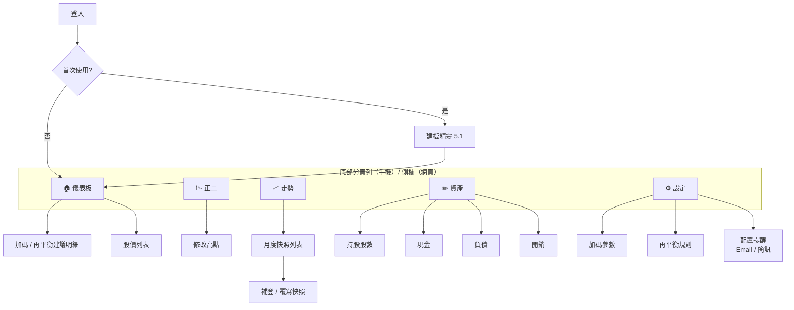

### 9.2 儀表板（手機線框）

```
┌────────────────────────────┐
│ 正二資產配置    10/29 13:25 ⟳ │
├────────────────────────────┤
│ 總金融資產      2,173.0 萬    │
│ 淨值 1,573.0萬  借貸 -600.0萬 │
│ 和上月差 +573.0萬 ▲35.8%      │
├────────────────────────────┤
│ 生活費 11.4 倍 → 建議 163     │
│ 目前 ███▓▓▓▓▓▓░░░            │
│ 原型 33% 正二 33% 現金 34%    │
│ 目標 █▓▓▓▓▓▓░░░              │
│ 原型 10% 正二 60% 現金 30%    │
├────────────────────────────┤
│ ⚠ 再平衡建議                  │
│ 原型 +23%：賣 00662 約 500萬  │
│ 正二 −27%：買 00631L 約 587萬 │
│                    [查看明細] │
├────────────────────────────┤
│ 本金槓桿 1.38 Beta 1.00       │
│ 總曝險 1.38                   │
├────────────────────────────┤
│ 00662 124.10 ▲  0050 …       │
│ 00631L 36.88 ▼  00685L …     │
└────────────────────────────┘
│ 🏠  📉  📈  ✏️  ⚙️ │
```

### 9.3 正二頁（手機線框）

```
┌────────────────────────────┐
│ 正二高點與加碼    基準 00631L │
├────────────────────────────┤
│ 00631L 現價 36.88            │
│ 高點 41.32 (2026/07/15) ✎    │
│ 回檔 -10.7%  ■□□□ 第 1 階    │
│ 階梯 37.19 │33.06│28.92│24.79│20.66 │
├────────────────────────────┤
│ 00685L …  00675L …           │
├────────────────────────────┤
│ 加碼進度  5% / 上限 20%       │
│ ██████░░░░░░░░░░░░░░         │
│ 本次建議：買 00631L 108.6萬   │
│ ≈ 29 張；資金：活存           │
│ 下一階觸發：33.06（-20%）     │
└────────────────────────────┘
```

---

## 10. API 清單

| 方法 | 路徑 | 說明 |
|------|------|------|
| POST | /auth/login | 登入（Google / Email） |
| GET | /portfolio | 一次取得持股、現金、負債、開銷、設定、高點、最新報價 |
| PUT | /holdings/{symbol} | 更新某檔股數 |
| POST / PUT / DELETE | /cash-accounts[/{id}] | 現金帳戶增改刪 |
| POST / PUT / DELETE | /liabilities[/{id}] | 負債增改刪 |
| PUT | /expense-profile | 月生活費、年開銷覆寫 |
| POST / PUT / DELETE | /extra-expenses[/{id}] | 其他開銷增改刪 |
| GET | /quotes | 7 檔最新報價 |
| GET | /peaks | 三檔正二高點 |
| PUT | /peaks/{symbol} | 手動修改高點 |
| GET | /advice | 計算後的加碼建議＋再平衡建議 |
| GET | /snapshots?from=&to= | 月度快照（走勢圖） |
| POST | /snapshots | 存本月快照（手動） |
| PUT | /snapshots/{yearMonth} | 補登 / 覆寫某月 |
| DELETE | /snapshots/{yearMonth} | 刪除某月快照 |
| GET / PUT | /settings | 使用者設定（含 ui_mode 簡易/進階） |
| GET | /recommendations?status=PENDING | 待執行的加減碼推薦 |
| POST | /recommendations | 使用者主動詢問「現在該買/賣什麼」→ 即時產生推薦 |
| PUT | /recommendations/{id}/execute | 標記已執行，可選擇同步更新持股 |
| PUT | /recommendations/{id}/dismiss | 略過 |
| GET | /tiers | 配置級距表 |
| GET | /alerts | 提醒紀錄 |
| PUT | /alerts/{id}/read | 標為已讀 |
| GET | /notification-channels | 已設定的 Email / 簡訊 |
| POST | /notification-channels | 新增信箱或手機（會寄出驗證碼） |
| POST | /notification-channels/{id}/verify | 輸入驗證碼完成驗證 |
| PUT / DELETE | /notification-channels/{id} | 開關、改要收的提醒類型、刪除 |
| POST | /notification-channels/{id}/test | 寄一封 / 一則測試 |
| GET | /notification-deliveries | 寄送紀錄 |

**排程工作**

| 名稱 | 時間（台北） | 內容 |
|------|------|------|
| quote-intraday | 交易日 09:00–13:30 每分鐘 | 更新 quotes、高點、檢查提醒 |
| quote-close | 交易日 13:40 | 寫 price_daily |
| snapshot-monthly | 每月最後交易日 14:30 | 全使用者 AUTO 快照 |
| holiday-sync | 每年 12 月 | 同步證交所休市日 |

---

## 11. 非功能需求

| 類別 | 需求 |
|------|------|
| 裝置 | 手機優先（≥ 360px），桌機自適應；iOS Safari、Android Chrome、桌機 Chrome/Edge |
| 安裝 | PWA 可加入主畫面、全螢幕開啟 |
| 效能 | 開啟 2 秒內顯示快取資料；報價延遲 ≤ 1 分鐘 |
| 離線 | 無網路時顯示最後資料並標示時間 |
| 精度 | 金額計算使用十進位（避免浮點誤差），顯示四捨五入 |
| 單位 | 預設顯示「萬」，可切換「元 / 千元」（Excel 用千元） |
| 安全 | HTTPS、RLS、登入逾時、敏感資料不放網址參數 |
| 備份 | 資料庫每日備份；使用者可匯出 Excel / CSV |
| 免責 | 頁面註明「試算工具，非投資建議」 |

---

## 12. 介面模式：簡易版 / 進階版

**原則：預設簡易版。** 打開只看到「我有多少錢、配置正不正常、現在要不要動作」。想深入再展開或切換進階版。

### 12.1 兩種模式的差別

| 項目 | 簡易版（預設） | 進階版 |
|------|------|------|
| 首頁內容 | 總資產、和上月差、配置燈號、今日行動卡、迷你走勢 | 第 9.2 節完整儀表板 |
| 配置比例 | 一條三色橫條＋「正常 / 需調整」 | 目前 vs 目標兩條、偏離數字 |
| 槓桿指標 | 隱藏 | 本金槓桿、Beta、總曝險 |
| 正二 | 只顯示「回檔 X%、第幾階」 | 三檔高點、價格階梯、加碼進度 |
| 推薦 | 一句話＋「買哪檔、幾張」 | 完整明細、手續費、理由、計算過程 |
| 股價 | 隱藏（首頁不顯示） | 7 檔報價列 |
| 走勢圖 | 只有總金融資產一條線 | 可切換多系列、區間、級距標記 |
| 分頁 | 3 個：首頁・走勢・資產 | 5 個：儀表板・正二・走勢・資產・設定 |
| 建檔精靈 | 只問：持股股數、負債、月生活費 | 全部欄位（其他開銷、高點、補登歷史） |

切換方式：設定頁一個開關（寫入 `user_settings.ui_mode`）；簡易版每張卡片右下有「看更多 ›」，點了只展開該卡，不切換整個模式。

### 12.2 配置燈號規則（簡易版）

| 燈號 | 條件 | 文字 |
|------|------|------|
| 🟢 綠 | 三類偏離都在門檻內、無加碼觸發 | 配置正常，不用動作 |
| 🟡 黃 | 正二觸發加碼階梯 | 正二回檔，可以加碼 |
| 🔴 紅 | 任一類偏離超過門檻，或級距變更 | 配置跑掉了，建議調整 |

### 12.3 簡易版首頁線框

```
┌────────────────────────────┐
│ 早安 👋          10/29 13:25 │
├────────────────────────────┤
│        總金融資產             │
│        2,173 萬              │
│     比上個月 ▲ 573 萬         │
│  ╭──────────────────╮       │
│  │ 迷你走勢 ／￣＼／￣ │       │
│  ╰──────────────────╯       │
├────────────────────────────┤
│ 🔴 配置跑掉了，建議調整        │
│ ███▓▓▓▓▓▓░░░░               │
│ 原型 33%・正二 33%・現金 34%  │
├────────────────────────────┤
│ 💡 今天建議                   │
│ 賣 00662   40 張             │
│ 買 00631L  158 張            │
│ 做完後 → 原型 10%・正二 60%   │
│ [我已完成]  [看更多 ›]        │
└────────────────────────────┘
│   🏠 首頁   📈 走勢   ✏️ 資產  │
```

### 12.4 操作性設計原則

| 原則 | 做法 |
|------|------|
| 一頁一件事 | 首頁只回答「現在要不要動作」 |
| 大字、少數字 | 金額以「萬」顯示、不帶小數；百分比取整數 |
| 拇指可及 | 主要按鈕在畫面下半部；底部分頁列 |
| 輸入簡單 | 股數用數字鍵盤；可切「張」；改完即時看到總資產變化 |
| 下拉更新 | 首頁下拉刷新股價 |
| 確認再寫入 | 「我已完成」會先顯示將更新的持股，確認後才改 |
| 不嚇人 | 紅燈文字用「建議調整」，不用「警告」；附一句原因 |

---

## 13. AI 加減碼推薦（推薦標的＋股數）

### 13.1 角色分工

| 層 | 負責 | 說明 |
|------|------|------|
| ① 規則引擎（5.4、5.5） | 算出**每一類要買／賣多少錢** | 依公式，結果可驗算 |
| ② 推薦引擎 TradeRecommender | 依**目前持股**挑出**哪幾檔**、換算**幾張＋幾股** | 確定性計算，同樣輸入同樣結果 |
| ③ AI 說明 AIExplainer | 把結果寫成白話、回答使用者追問 | **只能說明，不能改數字** |

> 為什麼數字不交給 AI 算：金額、股數必須正確且可重現；AI 只用來把結果講清楚、回答「為什麼是這檔」。

### 13.2 推薦引擎：挑選標的規則

**買入**（每個候選標的計分，分數高者優先）

| 因素 | 加分方式 | 理由 |
|------|------|------|
| 使用者設定的買入標的 | +40 | 尊重使用者偏好 |
| 目前已持有 | +20 | 不增加持股檔數，方便管理 |
| 同類別中目前占比偏低 | 最多 +15 | 同類分散（例：正二三檔間不要過度集中） |
| 成交量 | 最多 +10 | 流動性好，買賣價差小 |
| 折溢價（若有淨值資料） | 溢價越高扣分 | 避免買貴 |
| 內扣費用 | 越低越加分 | 長期成本 |
| 一張價格 ≤ 可用金額 | 必要條件（不允許零股時） | 買得起整張 |

- 金額小於 300 萬 → 只推 1 檔；大於等於 300 萬 → 最多拆 2 檔（門檻可調）
- 2330 為個股，預設不列入買入候選（設定可開啟）

**賣出**

| 因素 | 規則 |
|------|------|
| 使用者自訂賣出順序 | 有設定就照順序 |
| 持有市值最大者 | 預設優先賣 |
| 溢價較高者 | 加分（賣在相對貴的時候） |
| 不可超賣 | 每檔賣出 ≤ 持有股數；不夠就換下一檔 |

### 13.3 股數換算

```
可用金額     = 建議金額 −（買入時）預估手續費
張數         = floor(可用金額 ÷ (股價 × 1000))
剩餘金額     = 可用金額 − 張數 × 股價 × 1000
零股數       = allow_odd_lot ? floor(剩餘金額 ÷ 股價) : 0
手續費       = 成交金額 × 0.1425%（最低 20 元；可設折扣）
交易稅（賣） = ETF 0.1%、個股 0.3%
```

**檢查**
- 買入總額 ≤ 可動用現金（活存 → 00865B → 定存）
- 買完後現金 ≥ 保留現金 10%
- 若整張買不起又不允許零股 → 改推下一個候選，或提示「金額不足一張」

### 13.4 推薦流程

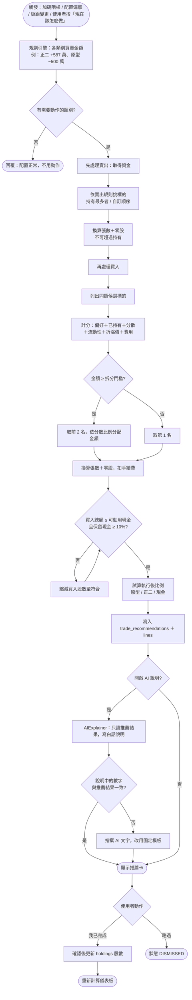

### 13.5 推薦結果範例

情境：生活費 11.4 倍 → 163；目前原型 33%、正二 33%、現金 34%；總金融資產 2,173 萬。

| 動作 | 標的 | 張 | 零股 | 預估金額 | 理由 |
|------|------|------|------|------|------|
| 賣 | 00662 | 40 | 290 | 約 500 萬 | 原型超出 23%，你只持有這檔市值型 |
| 買 | 00631L | 158 | 938 | 約 587 萬（含手續費） | 你的設定買入標的；與 00685L 占比較均衡 |

執行後：原型 10%・正二 60%・現金 30% ✅

**AI 白話說明（範例）**
> 你的資產大約是 11 年生活費，建議配置是原型一成、正二六成、現金三成。目前原型偏多、正二偏少，所以建議賣出部分 00662，把錢加到 00631L。賣完買完後，現金仍維持三成，回檔時還有加碼空間。

### 13.6 AI 互動（進階版可用）

使用者可在推薦卡點「問 AI」，例如：
- 「為什麼不買 00685L？」→ 依計分結果說明
- 「如果我只想動 300 萬呢？」→ 以 300 萬為上限重新呼叫推薦引擎，再由 AI 說明
- 「下一次加碼是什麼價位？」→ 讀取正二階梯回答

AI 輸入只給：推薦結果、PortfolioSummary、持股、設定（不含 email 等個資）。所有回覆附「試算結果，非投資建議」。

---

## 14. 配置提醒：Email / 簡訊

使用者在設定頁選擇用 **Email**、**簡訊**，或兩者都開。App 內的提醒卡照常顯示，Email / 簡訊是讓人不打開 App 也知道要動作。

### 14.1 提醒類型

| 類型 | 觸發條件 | 預設 Email | 預設簡訊 |
|------|------|------|------|
| ADD_POSITION 加碼 | 正二回檔跨過新的一階（-10%、-20%…） | ✅ | ✅ |
| REBALANCE 再平衡 | 任一類偏離超過門檻 ±5% | ✅ | ✅ |
| TIER_CHANGE 級距變更 | 生活費倍數跨級距（例：163 → 253） | ✅ | ☐ |
| NEW_PEAK 正二新高 | 加碼後正二創新高，建議回補現金 | ✅ | ☐ |
| MONTHLY_REPORT 月報 | 月底快照完成：本月資產、和上月差、走勢圖 | ✅ | ☐ |

> 簡訊按則計費，預設只開「需要動作」的兩類；使用者可自行勾選。

### 14.2 寄送規則

| 規則 | 說明 |
|------|------|
| 去重 | 同一事件只寄一次（alert_key，例：`ADD:00631L:週期3:第2階`）；回升再跌回同一階不重寄 |
| 偏離提醒冷卻 | 再平衡提醒同一類別 3 個交易日內不重寄，除非偏離再擴大 5% |
| 勿擾時段 | 預設 22:00–08:00，期間的提醒延到 08:00 寄出（盤中觸發通常不受影響） |
| 簡訊每日上限 | 預設 3 則，超過的只寄 Email，並在隔日 Email 彙整 |
| 合併寄送 | 同一次報價更新觸發多個提醒時，合併成一封 / 一則 |
| 失敗重試 | 間隔 1、5、15 分鐘重試，3 次失敗標記 FAILED；簡訊失敗自動改寄 Email |
| 僅寄已驗證 | 信箱與手機都需輸入驗證碼後才會寄送 |
| 取消訂閱 | Email 底部附「取消此類提醒」連結；簡訊可回覆或到設定頁關閉 |

### 14.3 內容範本

**簡訊（70 字內，中文一則上限）**

```
【正二配置】00631L 回檔 -20%，建議加碼：買 00631L 29 張（約 108 萬）。詳情：https://xxx.app/a/8K2
```

```
【正二配置】配置偏離：正二 68%（目標 60%）。建議賣 00685L 142 張補現金。詳情：https://xxx.app/a/9F1
```

- 只放「發生什麼＋要做什麼＋短網址」
- 不放總資產金額等敏感數字（簡訊可能被旁人看到、留存在電信端）
- 短網址開啟後需登入才看得到明細

**Email**

| 區塊 | 內容 |
|------|------|
| 主旨 | 【正二配置】00631L 回檔 -20%，建議加碼 |
| 第一段 | 一句話結論（同簡訊） |
| 建議明細 | 推薦表：買 / 賣、標的、張數、零股、預估金額 |
| 執行後配置 | 原型 / 正二 / 現金 目前 → 執行後 |
| AI 白話說明 | 第 13.5 節同款 |
| 按鈕 | 「打開 App 查看」「我已完成」（點了進 App 確認後更新持股） |
| 頁尾 | 試算結果，非投資建議・調整提醒設定・取消此類提醒 |

> Email 可顯示金額，但預設以「萬」為單位且不顯示總資產；使用者可在設定開啟「Email 顯示總資產」。

### 14.4 寄送流程

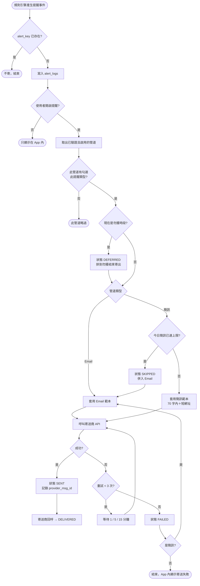

### 14.5 設定提醒方式（驗證流程）

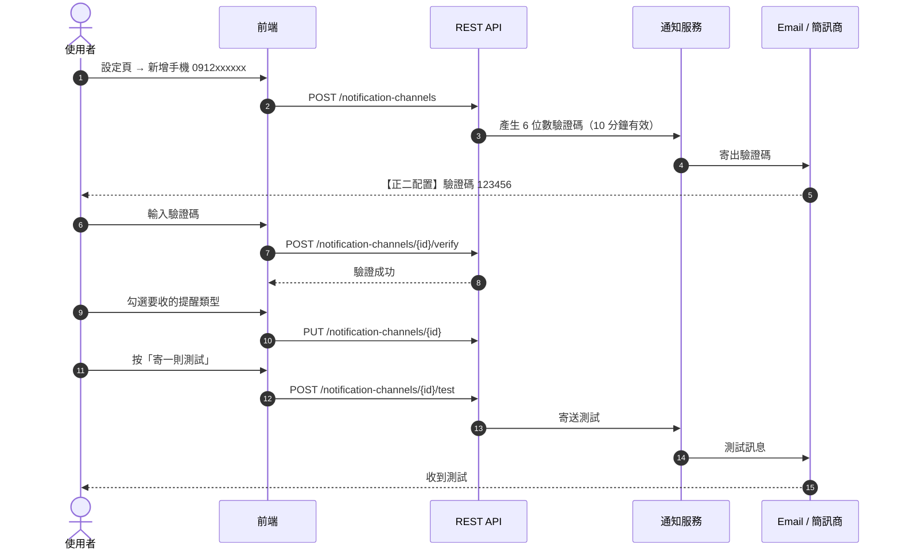

### 14.6 設定頁線框

```
┌────────────────────────────┐
│ 配置提醒                [開] │
├────────────────────────────┤
│ ✉ Email                    │
│ holmes•••@gmail.com ✅已驗證 │
│ ☑ 加碼 ☑ 再平衡 ☑ 級距變更     │
│ ☑ 正二新高 ☑ 月報            │
│ [寄測試信]                   │
├────────────────────────────┤
│ 💬 簡訊                     │
│ 0912•••678 ✅已驗證          │
│ ☑ 加碼 ☑ 再平衡 ☐ 級距變更     │
│ 每日上限 [3] 則              │
│ [寄測試簡訊]                 │
├────────────────────────────┤
│ 勿擾時段  22:00 – 08:00      │
├────────────────────────────┤
│ 最近寄送                     │
│ 10/28 10:12 簡訊 加碼 ✅送達  │
│ 10/28 10:12 Email 加碼 ✅送達 │
└────────────────────────────┘
```

### 14.7 寄送服務選型

| 管道 | 建議 | 說明 |
|------|------|------|
| Email | SendGrid、AWS SES、Resend 擇一 | 需設定寄件網域 SPF / DKIM，避免進垃圾信 |
| 簡訊 | 三竹簡訊、EVERY8D（台灣業者）；或 Twilio | 台灣門號送達率與速度以本地業者較穩；皆按則計費 |
| 架構 | 通知服務只依介面呼叫，寄送商可替換 | 之後要加 LINE 通知也只是多一個管道 |

### 14.8 個資與安全

- 手機號碼、信箱加密儲存；畫面只顯示遮罩（0912•••678）
- 簡訊不含金額與總資產；Email 預設不含總資產
- 短網址連到 App，需登入才看得到內容，連結 7 天失效
- 驗證碼限 10 分鐘、錯誤 5 次鎖定 30 分鐘，防止被拿來亂發簡訊

---

## 15. 技術選型

### 15.1 總覽

| 層 | 技術 | 說明 |
|------|------|------|
| 前端框架 | **Vue 3** | 比 React 好上手、中文資源多，適合前端不熟悉者 |
| UI 元件庫 | **Quasar** | 一套程式同時做網頁、手機 PWA；內建卡片、底部分頁、下拉刷新、數字輸入等元件；之後可用 Capacitor 打包上架 App Store / Google Play，不必重寫 |
| 狀態管理 | Pinia | Vue 官方推薦 |
| 圖表 | ECharts（vue-echarts） | 月度走勢圖、配置比例圖；中文文件完整 |
| 前端金額計算 | decimal.js | 避免浮點誤差（只用於編輯預覽） |
| 後端框架 | **Spring Boot 3 + Java 21** | |
| 資料存取 | Spring Data JPA | 金額一律 `BigDecimal` |
| DB 版本管理 | Flyway | 第 7 節資料表設計轉為版本化 SQL 腳本 |
| 登入 | Spring Security + OAuth2（Google）＋ Email | |
| 排程 | `@Scheduled` + ShedLock | 盤中報價、收盤、月底快照；ShedLock 避免多台主機重複執行 |
| Email | Spring Mail ＋ SendGrid / AWS SES | |
| 簡訊 | 三竹 / EVERY8D / Twilio API | 透過通知服務介面呼叫，可替換 |
| AI 說明 | 大型語言模型 API | 只做白話說明，不產生數字（第 13 節） |
| 資料庫 | **Neon PostgreSQL（免費方案）** | 見 15.3 |

### 15.2 計算引擎分工

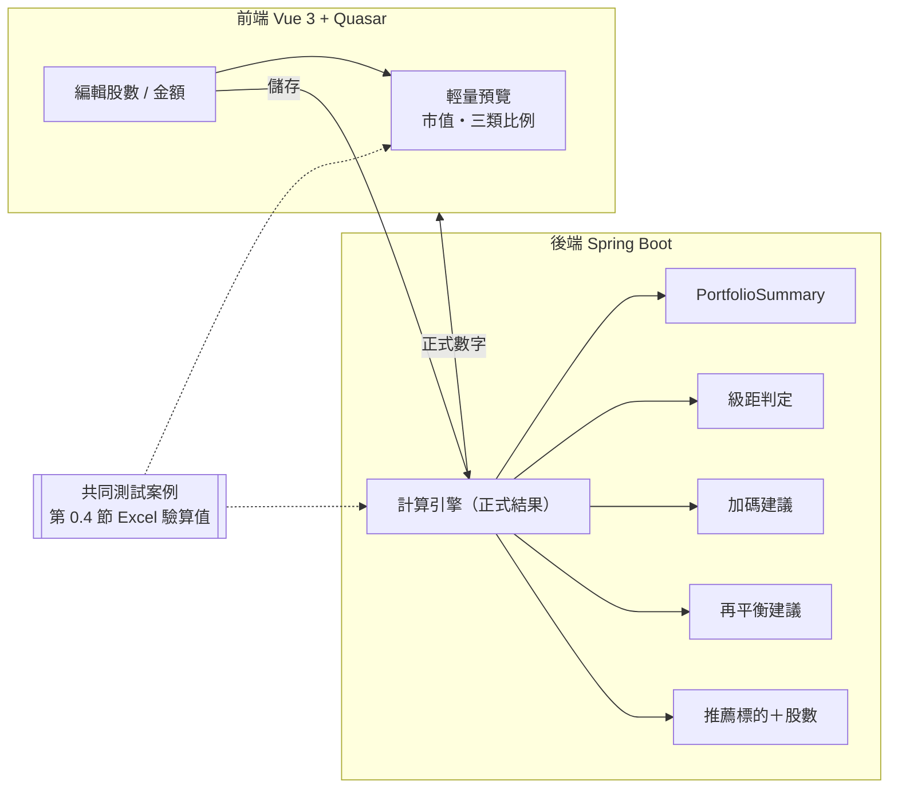

- 正式數字（儀表板、月度快照、推薦、Email / 簡訊提醒）**一律由後端計算**
- 前端預覽只算市值與三類比例，讓使用者改股數時立即看到變化；儲存後以後端結果為準
- 前後端各自用第 0.4 節 Excel 驗算值寫單元測試，確保公式一致

### 15.3 資料庫：Neon PostgreSQL

| 項目 | 免費方案內容 | 本系統需求 |
|------|------|------|
| 儲存空間 | 每專案 1 GB | 7 檔日價格＋月度快照，一年僅數 MB |
| 運算時數 | 每專案每月 100 CU-hours | 盤中每分鐘報價，約每月 100 小時 × 0.25 CU ≈ 25 CU-hours |
| 閒置休眠 | 閒置 5 分鐘自動休眠，下次連線自動喚醒 | 休眠後第一次查詢稍慢，可接受 |
| 超過額度 | 暫停運算到下個月，資料不會刪除 | 依估算不會超過 |

**選 Neon 不選 Supabase 的原因**
- Supabase 免費方案閒置一週會暫停、需手動恢復；台股春節休市可能超過一週，排程不跑時有被暫停風險
- Supabase 的優勢是內建登入與自動 API，但本系統由 Spring Boot 處理，用不到
- Supabase 免費容量 500 MB，Neon 為 1 GB

> 免費方案額度可能調整，正式上線前請再至官網確認。

**連線設定重點**
- Spring Boot 以 JDBC 連線，需開啟 SSL（`sslmode=require`）
- 連線池（HikariCP）設定較短的閒置逾時，配合 Neon 休眠
- 帳號密碼放環境變數，不寫進程式碼

### 15.4 待決定

| 項目 | 說明 |
|------|------|
| Spring Boot 主機 | 需要免費或低成本主機；注意多數免費主機閒置會休眠，休眠時盤中每分鐘報價排程無法執行，需另行規劃（例如外部定時喚醒或改用不休眠方案） |
| Email / 簡訊業者 | 簡訊按則計費，需選定業者並申請帳號 |
| AI 模型 | 選定 AI 說明使用的模型與費用上限 |
